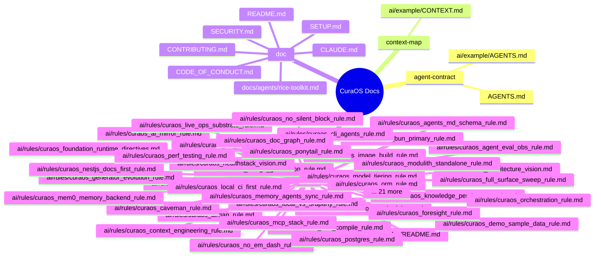

# CuraOS Document Graph

Generated by `scripts/check-doc-graph.js --write`. Do not edit relationship tables by hand.

## Method

- Every Markdown file is a graph node.
- Explicit Markdown links and wikilinks become `references` / `wikilink` edges.
- Path conventions infer typed edges: `AGENTS.md` governs or `README.md` introduces a repo slice, `CONTEXT.md` contextualizes, `Requirements.md` specifies, `RESOLUTION-MAP.md` indexes ADR status, and `ai/rules/README.md` indexes rules.
- Historical research stays in the graph but does not override rules or ADR status.

## Summary

- Nodes: 71
- Edges: 716
- Isolated nodes: 0
- Broken links: 0

## Node Counts

| Type | Count |
|---|---:|
| agent-contract | 2 |
| context-map | 1 |
| doc | 7 |
| rule | 61 |

## Mind Map

## Nodes

| File | Type | In | Out | Title |
|---|---|---:|---:|---|
| [AGENTS.md](../../../AGENTS.md) | agent-contract | 71 | 132 | AGENTS.md - Workspace Example |
| [CLAUDE.md](../../../CLAUDE.md) | doc | 1 | 1 | CLAUDE.md |
| [CODE_OF_CONDUCT.md](../../../CODE_OF_CONDUCT.md) | doc | 1 | 1 | Code of Conduct |
| [CONTRIBUTING.md](../../../CONTRIBUTING.md) | doc | 2 | 1 | Contributing |
| [README.md](../../../README.md) | doc | 1 | 8 | CuraOS Workspace Example |
| [SECURITY.md](../../../SECURITY.md) | doc | 2 | 1 | Security Policy |
| [SETUP.md](../../../SETUP.md) | doc | 4 | 3 | Setup |
| [ai/example/AGENTS.md](../AGENTS.md) | agent-contract | 2 | 3 | Example Project Agent Contract |
| [ai/example/CONTEXT.md](../CONTEXT.md) | context-map | 4 | 2 | Example project context |
| [ai/rules/README.md](../../rules/README.md) | rule | 123 | 128 | Workspace Rules |
| [ai/rules/curaos_agent_eval_obs_rule.md](../../rules/curaos_agent_eval_obs_rule.md) | rule | 7 | 16 | tests/agent_evals/test_identity_service.py |
| [ai/rules/curaos_agents_md_schema_rule.md](../../rules/curaos_agents_md_schema_rule.md) | rule | 10 | 9 | curaos_agents_md_schema_rule.md |
| [ai/rules/curaos_ai_mirror_rule.md](../../rules/curaos_ai_mirror_rule.md) | rule | 18 | 4 | curaos_ai_mirror_rule.md |
| [ai/rules/curaos_airgap_rule.md](../../rules/curaos_airgap_rule.md) | rule | 9 | 12 | packages/curaos/zarf.yaml |
| [ai/rules/curaos_architecture_vision.md](../../rules/curaos_architecture_vision.md) | rule | 6 | 4 | curaos_architecture_vision.md |
| [ai/rules/curaos_bun_compile_rule.md](../../rules/curaos_bun_compile_rule.md) | rule | 4 | 8 | Bun compile packaging rule |
| [ai/rules/curaos_bun_primary_rule.md](../../rules/curaos_bun_primary_rule.md) | rule | 19 | 3 | curaos_bun_primary_rule.md |
| [ai/rules/curaos_caveman_rule.md](../../rules/curaos_caveman_rule.md) | rule | 5 | 7 | CuraOS Caveman Rule |
| [ai/rules/curaos_cli_agents_rule.md](../../rules/curaos_cli_agents_rule.md) | rule | 11 | 4 | Per-project agent tooling |
| [ai/rules/curaos_cni_rule.md](../../rules/curaos_cni_rule.md) | rule | 10 | 8 | K3s server install w/ Flannel + kube-proxy disabled (NetworkPolicy too - Cilium takes over) |
| [ai/rules/curaos_context_engineering_rule.md](../../rules/curaos_context_engineering_rule.md) | rule | 7 | 11 | High-frequency session (>3 reads per 5 min) - default 5-min TTL OK |
| [ai/rules/curaos_decision_methodology.md](../../rules/curaos_decision_methodology.md) | rule | 7 | 3 | curaos_decision_methodology.md |
| [ai/rules/curaos_demo_sample_data_rule.md](../../rules/curaos_demo_sample_data_rule.md) | rule | 5 | 6 | CuraOS Demo/Sample Data Rule |
| [ai/rules/curaos_design_generation_rule.md](../../rules/curaos_design_generation_rule.md) | rule | 5 | 5 | Design Generation Rule (OpenDesign-driven, generator-ingestable) |
| [ai/rules/curaos_doc_graph_rule.md](../../rules/curaos_doc_graph_rule.md) | rule | 7 | 3 | CuraOS Doc Graph Rule |
| [ai/rules/curaos_error_tracking_rule.md](../../rules/curaos_error_tracking_rule.md) | rule | 11 | 11 | curaos_error_tracking_rule.md |
| [ai/rules/curaos_foresight_rule.md](../../rules/curaos_foresight_rule.md) | rule | 7 | 4 | Discovered work |
| [ai/rules/curaos_foundation_runtime_directives.md](../../rules/curaos_foundation_runtime_directives.md) | rule | 6 | 3 | curaos_foundation_runtime_directives.md |
| [ai/rules/curaos_full_surface_sweep_rule.md](../../rules/curaos_full_surface_sweep_rule.md) | rule | 4 | 8 | Full-surface sweep rule (binding) |
| [ai/rules/curaos_generator_evolution_rule.md](../../rules/curaos_generator_evolution_rule.md) | rule | 11 | 11 | CuraOS Generator-Evolution Rule |
| [ai/rules/curaos_healthstack_vision.md](../../rules/curaos_healthstack_vision.md) | rule | 8 | 3 | curaos_healthstack_vision.md |
| [ai/rules/curaos_image_build_rule.md](../../rules/curaos_image_build_rule.md) | rule | 11 | 9 | Bun-first base per curaos_bun_primary_rule |
| [ai/rules/curaos_knowledge_persistence_rule.md](../../rules/curaos_knowledge_persistence_rule.md) | rule | 9 | 4 | Working knowledge through Rice |
| [ai/rules/curaos_live_ops_substrate_rule.md](../../rules/curaos_live_ops_substrate_rule.md) | rule | 7 | 3 | Live Ops Substrate Rule |
| [ai/rules/curaos_local_ci_first_rule.md](../../rules/curaos_local_ci_first_rule.md) | rule | 8 | 7 | curaos_local_ci_first_rule.md |
| [ai/rules/curaos_local_vs_3rdparty_rule.md](../../rules/curaos_local_vs_3rdparty_rule.md) | rule | 13 | 3 | curaos_local_vs_3rdparty_rule.md |
| [ai/rules/curaos_mcp_stack_rule.md](../../rules/curaos_mcp_stack_rule.md) | rule | 14 | 14 | curaos_mcp_stack_rule.md |
| [ai/rules/curaos_mem0_memory_backend_rule.md](../../rules/curaos_mem0_memory_backend_rule.md) | rule | 5 | 6 | curaos_mem0_memory_backend_rule.md |
| [ai/rules/curaos_memory_agents_sync_rule.md](../../rules/curaos_memory_agents_sync_rule.md) | rule | 15 | 4 | Memory must NOT contain rule files (other than this sync rule + reference memories) |
| [ai/rules/curaos_model_tiering_rule.md](../../rules/curaos_model_tiering_rule.md) | rule | 8 | 7 | curaos_model_tiering_rule.md |
| [ai/rules/curaos_modulith_standalone_rule.md](../../rules/curaos_modulith_standalone_rule.md) | rule | 17 | 3 | curaos_modulith_standalone_rule.md |
| [ai/rules/curaos_nestjs_docs_first_rule.md](../../rules/curaos_nestjs_docs_first_rule.md) | rule | 5 | 4 | curaos_nestjs_docs_first_rule.md |
| [ai/rules/curaos_no_em_dash_rule.md](../../rules/curaos_no_em_dash_rule.md) | rule | 6 | 3 | Rule: never use em-dashes |
| [ai/rules/curaos_no_silent_block_rule.md](../../rules/curaos_no_silent_block_rule.md) | rule | 5 | 6 | No Silent Block: escalate every blocker to the user immediately |
| [ai/rules/curaos_orchestration_rule.md](../../rules/curaos_orchestration_rule.md) | rule | 14 | 16 | Zarf one-shot: |
| [ai/rules/curaos_orm_rule.md](../../rules/curaos_orm_rule.md) | rule | 8 | 3 | curaos_orm_rule.md |
| [ai/rules/curaos_perf_testing_rule.md](../../rules/curaos_perf_testing_rule.md) | rule | 4 | 13 | .github/workflows/perf-smoke.yml (PR) |
| [ai/rules/curaos_ponytail_rule.md](../../rules/curaos_ponytail_rule.md) | rule | 5 | 7 | CuraOS Ponytail Rule |
| [ai/rules/curaos_postgres_rule.md](../../rules/curaos_postgres_rule.md) | rule | 14 | 13 | curaos_postgres_rule.md |
| [ai/rules/curaos_quality_gates_rule.md](../../rules/curaos_quality_gates_rule.md) | rule | 14 | 23 | lefthook.yml |
| [ai/rules/curaos_recommendation_auto_apply_rule.md](../../rules/curaos_recommendation_auto_apply_rule.md) | rule | 8 | 6 | Recommendation Auto-Apply Rule |
| [ai/rules/curaos_repo_boundary_rule.md](../../rules/curaos_repo_boundary_rule.md) | rule | 9 | 3 | curaos_repo_boundary_rule.md |
| [ai/rules/curaos_repo_conventions_rule.md](../../rules/curaos_repo_conventions_rule.md) | rule | 8 | 11 | curaos_repo_conventions_rule.md |
| [ai/rules/curaos_reuse_dry_rule.md](../../rules/curaos_reuse_dry_rule.md) | rule | 6 | 3 | CuraOS Reuse + DRY Rule |
| [ai/rules/curaos_rn_e2e_rule.md](../../rules/curaos_rn_e2e_rule.md) | rule | 5 | 10 | apps/clinician-app/.maestro/login-and-view-patient.yaml |
| [ai/rules/curaos_roadmap_workflow_rule.md](../../rules/curaos_roadmap_workflow_rule.md) | rule | 8 | 4 | Rice task graph |
| [ai/rules/curaos_rolling_update_rule.md](../../rules/curaos_rolling_update_rule.md) | rule | 6 | 8 | e.g. signal:auth-diamond-divergence == 0 (over the gauge's own sampling window) |
| [ai/rules/curaos_runtime_decisions.md](../../rules/curaos_runtime_decisions.md) | rule | 4 | 3 | curaos_runtime_decisions.md |
| [ai/rules/curaos_self_serve_no_user_handoff_rule.md](../../rules/curaos_self_serve_no_user_handoff_rule.md) | rule | 6 | 5 | Self-serve: never hand the user work the agent can do |
| [ai/rules/curaos_slo_rule.md](../../rules/curaos_slo_rule.md) | rule | 10 | 12 | Generated by Codegen recipe nestjs-service-v1 |
| [ai/rules/curaos_speed_patterns_rule.md](../../rules/curaos_speed_patterns_rule.md) | rule | 6 | 16 | Backend service via Nx |
| [ai/rules/curaos_stack_priorities.md](../../rules/curaos_stack_priorities.md) | rule | 4 | 3 | curaos_stack_priorities.md |
| [ai/rules/curaos_swarm_collaboration_rule.md](../../rules/curaos_swarm_collaboration_rule.md) | rule | 8 | 4 | Native collaboration |
| [ai/rules/curaos_symphony_alignment_rule.md](../../rules/curaos_symphony_alignment_rule.md) | rule | 4 | 4 | Symphony alignment through Rice |
| [ai/rules/curaos_triplet_split_rule.md](../../rules/curaos_triplet_split_rule.md) | rule | 4 | 3 | CuraOS Triplet Split Rule |
| [ai/rules/curaos_validation_rule.md](../../rules/curaos_validation_rule.md) | rule | 8 | 4 | curaos_validation_rule.md |
| [ai/rules/curaos_verification_stack_rule.md](../../rules/curaos_verification_stack_rule.md) | rule | 14 | 17 | lefthook.yml (excerpt) |
| [ai/rules/curaos_verify_before_build_rule.md](../../rules/curaos_verify_before_build_rule.md) | rule | 7 | 8 | curaos_verify_before_build_rule.md |
| [ai/rules/curaos_version_pinning_rule.md](../../rules/curaos_version_pinning_rule.md) | rule | 8 | 12 | Bad |
| [ai/rules/curaos_version_planning_rule.md](../../rules/curaos_version_planning_rule.md) | rule | 4 | 8 | CuraOS Version-Planning Rule |
| [docs/agents/rice-toolkit.md](../../../docs/agents/rice-toolkit.md) | doc | 8 | 1 | Consume maintained Rice tooling |

## Edges

| From | Relationship | To | Note |
|---|---|---|---|
| [AGENTS.md](../../../AGENTS.md) | governs | [ai/example/AGENTS.md](../AGENTS.md) |  |
| [AGENTS.md](../../../AGENTS.md) | governs | [ai/example/CONTEXT.md](../CONTEXT.md) |  |
| [AGENTS.md](../../../AGENTS.md) | governs | [ai/rules/curaos_agent_eval_obs_rule.md](../../rules/curaos_agent_eval_obs_rule.md) |  |
| [AGENTS.md](../../../AGENTS.md) | governs | [ai/rules/curaos_agents_md_schema_rule.md](../../rules/curaos_agents_md_schema_rule.md) |  |
| [AGENTS.md](../../../AGENTS.md) | governs | [ai/rules/curaos_ai_mirror_rule.md](../../rules/curaos_ai_mirror_rule.md) |  |
| [AGENTS.md](../../../AGENTS.md) | governs | [ai/rules/curaos_airgap_rule.md](../../rules/curaos_airgap_rule.md) |  |
| [AGENTS.md](../../../AGENTS.md) | governs | [ai/rules/curaos_architecture_vision.md](../../rules/curaos_architecture_vision.md) |  |
| [AGENTS.md](../../../AGENTS.md) | governs | [ai/rules/curaos_bun_compile_rule.md](../../rules/curaos_bun_compile_rule.md) |  |
| [AGENTS.md](../../../AGENTS.md) | governs | [ai/rules/curaos_bun_primary_rule.md](../../rules/curaos_bun_primary_rule.md) |  |
| [AGENTS.md](../../../AGENTS.md) | governs | [ai/rules/curaos_caveman_rule.md](../../rules/curaos_caveman_rule.md) |  |
| [AGENTS.md](../../../AGENTS.md) | governs | [ai/rules/curaos_cli_agents_rule.md](../../rules/curaos_cli_agents_rule.md) |  |
| [AGENTS.md](../../../AGENTS.md) | governs | [ai/rules/curaos_cni_rule.md](../../rules/curaos_cni_rule.md) |  |
| [AGENTS.md](../../../AGENTS.md) | governs | [ai/rules/curaos_context_engineering_rule.md](../../rules/curaos_context_engineering_rule.md) |  |
| [AGENTS.md](../../../AGENTS.md) | governs | [ai/rules/curaos_decision_methodology.md](../../rules/curaos_decision_methodology.md) |  |
| [AGENTS.md](../../../AGENTS.md) | governs | [ai/rules/curaos_demo_sample_data_rule.md](../../rules/curaos_demo_sample_data_rule.md) |  |
| [AGENTS.md](../../../AGENTS.md) | governs | [ai/rules/curaos_design_generation_rule.md](../../rules/curaos_design_generation_rule.md) |  |
| [AGENTS.md](../../../AGENTS.md) | governs | [ai/rules/curaos_doc_graph_rule.md](../../rules/curaos_doc_graph_rule.md) |  |
| [AGENTS.md](../../../AGENTS.md) | governs | [ai/rules/curaos_error_tracking_rule.md](../../rules/curaos_error_tracking_rule.md) |  |
| [AGENTS.md](../../../AGENTS.md) | governs | [ai/rules/curaos_foresight_rule.md](../../rules/curaos_foresight_rule.md) |  |
| [AGENTS.md](../../../AGENTS.md) | governs | [ai/rules/curaos_foundation_runtime_directives.md](../../rules/curaos_foundation_runtime_directives.md) |  |
| [AGENTS.md](../../../AGENTS.md) | governs | [ai/rules/curaos_full_surface_sweep_rule.md](../../rules/curaos_full_surface_sweep_rule.md) |  |
| [AGENTS.md](../../../AGENTS.md) | governs | [ai/rules/curaos_generator_evolution_rule.md](../../rules/curaos_generator_evolution_rule.md) |  |
| [AGENTS.md](../../../AGENTS.md) | governs | [ai/rules/curaos_healthstack_vision.md](../../rules/curaos_healthstack_vision.md) |  |
| [AGENTS.md](../../../AGENTS.md) | governs | [ai/rules/curaos_image_build_rule.md](../../rules/curaos_image_build_rule.md) |  |
| [AGENTS.md](../../../AGENTS.md) | governs | [ai/rules/curaos_knowledge_persistence_rule.md](../../rules/curaos_knowledge_persistence_rule.md) |  |
| [AGENTS.md](../../../AGENTS.md) | governs | [ai/rules/curaos_live_ops_substrate_rule.md](../../rules/curaos_live_ops_substrate_rule.md) |  |
| [AGENTS.md](../../../AGENTS.md) | governs | [ai/rules/curaos_local_ci_first_rule.md](../../rules/curaos_local_ci_first_rule.md) |  |
| [AGENTS.md](../../../AGENTS.md) | governs | [ai/rules/curaos_local_vs_3rdparty_rule.md](../../rules/curaos_local_vs_3rdparty_rule.md) |  |
| [AGENTS.md](../../../AGENTS.md) | governs | [ai/rules/curaos_mcp_stack_rule.md](../../rules/curaos_mcp_stack_rule.md) |  |
| [AGENTS.md](../../../AGENTS.md) | governs | [ai/rules/curaos_mem0_memory_backend_rule.md](../../rules/curaos_mem0_memory_backend_rule.md) |  |
| [AGENTS.md](../../../AGENTS.md) | governs | [ai/rules/curaos_memory_agents_sync_rule.md](../../rules/curaos_memory_agents_sync_rule.md) |  |
| [AGENTS.md](../../../AGENTS.md) | governs | [ai/rules/curaos_model_tiering_rule.md](../../rules/curaos_model_tiering_rule.md) |  |
| [AGENTS.md](../../../AGENTS.md) | governs | [ai/rules/curaos_modulith_standalone_rule.md](../../rules/curaos_modulith_standalone_rule.md) |  |
| [AGENTS.md](../../../AGENTS.md) | governs | [ai/rules/curaos_nestjs_docs_first_rule.md](../../rules/curaos_nestjs_docs_first_rule.md) |  |
| [AGENTS.md](../../../AGENTS.md) | governs | [ai/rules/curaos_no_em_dash_rule.md](../../rules/curaos_no_em_dash_rule.md) |  |
| [AGENTS.md](../../../AGENTS.md) | governs | [ai/rules/curaos_no_silent_block_rule.md](../../rules/curaos_no_silent_block_rule.md) |  |
| [AGENTS.md](../../../AGENTS.md) | governs | [ai/rules/curaos_orchestration_rule.md](../../rules/curaos_orchestration_rule.md) |  |
| [AGENTS.md](../../../AGENTS.md) | governs | [ai/rules/curaos_orm_rule.md](../../rules/curaos_orm_rule.md) |  |
| [AGENTS.md](../../../AGENTS.md) | governs | [ai/rules/curaos_perf_testing_rule.md](../../rules/curaos_perf_testing_rule.md) |  |
| [AGENTS.md](../../../AGENTS.md) | governs | [ai/rules/curaos_ponytail_rule.md](../../rules/curaos_ponytail_rule.md) |  |
| [AGENTS.md](../../../AGENTS.md) | governs | [ai/rules/curaos_postgres_rule.md](../../rules/curaos_postgres_rule.md) |  |
| [AGENTS.md](../../../AGENTS.md) | governs | [ai/rules/curaos_quality_gates_rule.md](../../rules/curaos_quality_gates_rule.md) |  |
| [AGENTS.md](../../../AGENTS.md) | governs | [ai/rules/curaos_recommendation_auto_apply_rule.md](../../rules/curaos_recommendation_auto_apply_rule.md) |  |
| [AGENTS.md](../../../AGENTS.md) | governs | [ai/rules/curaos_repo_boundary_rule.md](../../rules/curaos_repo_boundary_rule.md) |  |
| [AGENTS.md](../../../AGENTS.md) | governs | [ai/rules/curaos_repo_conventions_rule.md](../../rules/curaos_repo_conventions_rule.md) |  |
| [AGENTS.md](../../../AGENTS.md) | governs | [ai/rules/curaos_reuse_dry_rule.md](../../rules/curaos_reuse_dry_rule.md) |  |
| [AGENTS.md](../../../AGENTS.md) | governs | [ai/rules/curaos_rn_e2e_rule.md](../../rules/curaos_rn_e2e_rule.md) |  |
| [AGENTS.md](../../../AGENTS.md) | governs | [ai/rules/curaos_roadmap_workflow_rule.md](../../rules/curaos_roadmap_workflow_rule.md) |  |
| [AGENTS.md](../../../AGENTS.md) | governs | [ai/rules/curaos_rolling_update_rule.md](../../rules/curaos_rolling_update_rule.md) |  |
| [AGENTS.md](../../../AGENTS.md) | governs | [ai/rules/curaos_runtime_decisions.md](../../rules/curaos_runtime_decisions.md) |  |
| [AGENTS.md](../../../AGENTS.md) | governs | [ai/rules/curaos_self_serve_no_user_handoff_rule.md](../../rules/curaos_self_serve_no_user_handoff_rule.md) |  |
| [AGENTS.md](../../../AGENTS.md) | governs | [ai/rules/curaos_slo_rule.md](../../rules/curaos_slo_rule.md) |  |
| [AGENTS.md](../../../AGENTS.md) | governs | [ai/rules/curaos_speed_patterns_rule.md](../../rules/curaos_speed_patterns_rule.md) |  |
| [AGENTS.md](../../../AGENTS.md) | governs | [ai/rules/curaos_stack_priorities.md](../../rules/curaos_stack_priorities.md) |  |
| [AGENTS.md](../../../AGENTS.md) | governs | [ai/rules/curaos_swarm_collaboration_rule.md](../../rules/curaos_swarm_collaboration_rule.md) |  |
| [AGENTS.md](../../../AGENTS.md) | governs | [ai/rules/curaos_symphony_alignment_rule.md](../../rules/curaos_symphony_alignment_rule.md) |  |
| [AGENTS.md](../../../AGENTS.md) | governs | [ai/rules/curaos_triplet_split_rule.md](../../rules/curaos_triplet_split_rule.md) |  |
| [AGENTS.md](../../../AGENTS.md) | governs | [ai/rules/curaos_validation_rule.md](../../rules/curaos_validation_rule.md) |  |
| [AGENTS.md](../../../AGENTS.md) | governs | [ai/rules/curaos_verification_stack_rule.md](../../rules/curaos_verification_stack_rule.md) |  |
| [AGENTS.md](../../../AGENTS.md) | governs | [ai/rules/curaos_verify_before_build_rule.md](../../rules/curaos_verify_before_build_rule.md) |  |
| [AGENTS.md](../../../AGENTS.md) | governs | [ai/rules/curaos_version_pinning_rule.md](../../rules/curaos_version_pinning_rule.md) |  |
| [AGENTS.md](../../../AGENTS.md) | governs | [ai/rules/curaos_version_planning_rule.md](../../rules/curaos_version_planning_rule.md) |  |
| [AGENTS.md](../../../AGENTS.md) | governs | [ai/rules/README.md](../../rules/README.md) |  |
| [AGENTS.md](../../../AGENTS.md) | governs | [CLAUDE.md](../../../CLAUDE.md) |  |
| [AGENTS.md](../../../AGENTS.md) | governs | [CODE_OF_CONDUCT.md](../../../CODE_OF_CONDUCT.md) |  |
| [AGENTS.md](../../../AGENTS.md) | governs | [CONTRIBUTING.md](../../../CONTRIBUTING.md) |  |
| [AGENTS.md](../../../AGENTS.md) | governs | [docs/agents/rice-toolkit.md](../../../docs/agents/rice-toolkit.md) |  |
| [AGENTS.md](../../../AGENTS.md) | governs | [README.md](../../../README.md) |  |
| [AGENTS.md](../../../AGENTS.md) | governs | [SECURITY.md](../../../SECURITY.md) |  |
| [AGENTS.md](../../../AGENTS.md) | governs | [SETUP.md](../../../SETUP.md) |  |
| [AGENTS.md](../../../AGENTS.md) | references | [ai/rules/curaos_agent_eval_obs_rule.md](../../rules/curaos_agent_eval_obs_rule.md) |  |
| [AGENTS.md](../../../AGENTS.md) | references | [ai/rules/curaos_agents_md_schema_rule.md](../../rules/curaos_agents_md_schema_rule.md) |  |
| [AGENTS.md](../../../AGENTS.md) | references | [ai/rules/curaos_ai_mirror_rule.md](../../rules/curaos_ai_mirror_rule.md) |  |
| [AGENTS.md](../../../AGENTS.md) | references | [ai/rules/curaos_airgap_rule.md](../../rules/curaos_airgap_rule.md) |  |
| [AGENTS.md](../../../AGENTS.md) | references | [ai/rules/curaos_architecture_vision.md](../../rules/curaos_architecture_vision.md) |  |
| [AGENTS.md](../../../AGENTS.md) | references | [ai/rules/curaos_bun_compile_rule.md](../../rules/curaos_bun_compile_rule.md) |  |
| [AGENTS.md](../../../AGENTS.md) | references | [ai/rules/curaos_bun_primary_rule.md](../../rules/curaos_bun_primary_rule.md) |  |
| [AGENTS.md](../../../AGENTS.md) | references | [ai/rules/curaos_caveman_rule.md](../../rules/curaos_caveman_rule.md) |  |
| [AGENTS.md](../../../AGENTS.md) | references | [ai/rules/curaos_cli_agents_rule.md](../../rules/curaos_cli_agents_rule.md) |  |
| [AGENTS.md](../../../AGENTS.md) | references | [ai/rules/curaos_cni_rule.md](../../rules/curaos_cni_rule.md) |  |
| [AGENTS.md](../../../AGENTS.md) | references | [ai/rules/curaos_context_engineering_rule.md](../../rules/curaos_context_engineering_rule.md) |  |
| [AGENTS.md](../../../AGENTS.md) | references | [ai/rules/curaos_decision_methodology.md](../../rules/curaos_decision_methodology.md) |  |
| [AGENTS.md](../../../AGENTS.md) | references | [ai/rules/curaos_demo_sample_data_rule.md](../../rules/curaos_demo_sample_data_rule.md) |  |
| [AGENTS.md](../../../AGENTS.md) | references | [ai/rules/curaos_design_generation_rule.md](../../rules/curaos_design_generation_rule.md) |  |
| [AGENTS.md](../../../AGENTS.md) | references | [ai/rules/curaos_doc_graph_rule.md](../../rules/curaos_doc_graph_rule.md) |  |
| [AGENTS.md](../../../AGENTS.md) | references | [ai/rules/curaos_error_tracking_rule.md](../../rules/curaos_error_tracking_rule.md) |  |
| [AGENTS.md](../../../AGENTS.md) | references | [ai/rules/curaos_foresight_rule.md](../../rules/curaos_foresight_rule.md) |  |
| [AGENTS.md](../../../AGENTS.md) | references | [ai/rules/curaos_foundation_runtime_directives.md](../../rules/curaos_foundation_runtime_directives.md) |  |
| [AGENTS.md](../../../AGENTS.md) | references | [ai/rules/curaos_full_surface_sweep_rule.md](../../rules/curaos_full_surface_sweep_rule.md) |  |
| [AGENTS.md](../../../AGENTS.md) | references | [ai/rules/curaos_generator_evolution_rule.md](../../rules/curaos_generator_evolution_rule.md) |  |
| [AGENTS.md](../../../AGENTS.md) | references | [ai/rules/curaos_healthstack_vision.md](../../rules/curaos_healthstack_vision.md) |  |
| [AGENTS.md](../../../AGENTS.md) | references | [ai/rules/curaos_image_build_rule.md](../../rules/curaos_image_build_rule.md) |  |
| [AGENTS.md](../../../AGENTS.md) | references | [ai/rules/curaos_knowledge_persistence_rule.md](../../rules/curaos_knowledge_persistence_rule.md) |  |
| [AGENTS.md](../../../AGENTS.md) | references | [ai/rules/curaos_live_ops_substrate_rule.md](../../rules/curaos_live_ops_substrate_rule.md) |  |
| [AGENTS.md](../../../AGENTS.md) | references | [ai/rules/curaos_local_ci_first_rule.md](../../rules/curaos_local_ci_first_rule.md) |  |
| [AGENTS.md](../../../AGENTS.md) | references | [ai/rules/curaos_local_vs_3rdparty_rule.md](../../rules/curaos_local_vs_3rdparty_rule.md) |  |
| [AGENTS.md](../../../AGENTS.md) | references | [ai/rules/curaos_mcp_stack_rule.md](../../rules/curaos_mcp_stack_rule.md) |  |
| [AGENTS.md](../../../AGENTS.md) | references | [ai/rules/curaos_mem0_memory_backend_rule.md](../../rules/curaos_mem0_memory_backend_rule.md) |  |
| [AGENTS.md](../../../AGENTS.md) | references | [ai/rules/curaos_memory_agents_sync_rule.md](../../rules/curaos_memory_agents_sync_rule.md) |  |
| [AGENTS.md](../../../AGENTS.md) | references | [ai/rules/curaos_model_tiering_rule.md](../../rules/curaos_model_tiering_rule.md) |  |
| [AGENTS.md](../../../AGENTS.md) | references | [ai/rules/curaos_modulith_standalone_rule.md](../../rules/curaos_modulith_standalone_rule.md) |  |
| [AGENTS.md](../../../AGENTS.md) | references | [ai/rules/curaos_nestjs_docs_first_rule.md](../../rules/curaos_nestjs_docs_first_rule.md) |  |
| [AGENTS.md](../../../AGENTS.md) | references | [ai/rules/curaos_no_em_dash_rule.md](../../rules/curaos_no_em_dash_rule.md) |  |
| [AGENTS.md](../../../AGENTS.md) | references | [ai/rules/curaos_no_silent_block_rule.md](../../rules/curaos_no_silent_block_rule.md) |  |
| [AGENTS.md](../../../AGENTS.md) | references | [ai/rules/curaos_orchestration_rule.md](../../rules/curaos_orchestration_rule.md) |  |
| [AGENTS.md](../../../AGENTS.md) | references | [ai/rules/curaos_orm_rule.md](../../rules/curaos_orm_rule.md) |  |
| [AGENTS.md](../../../AGENTS.md) | references | [ai/rules/curaos_perf_testing_rule.md](../../rules/curaos_perf_testing_rule.md) |  |
| [AGENTS.md](../../../AGENTS.md) | references | [ai/rules/curaos_ponytail_rule.md](../../rules/curaos_ponytail_rule.md) |  |
| [AGENTS.md](../../../AGENTS.md) | references | [ai/rules/curaos_postgres_rule.md](../../rules/curaos_postgres_rule.md) |  |
| [AGENTS.md](../../../AGENTS.md) | references | [ai/rules/curaos_quality_gates_rule.md](../../rules/curaos_quality_gates_rule.md) |  |
| [AGENTS.md](../../../AGENTS.md) | references | [ai/rules/curaos_recommendation_auto_apply_rule.md](../../rules/curaos_recommendation_auto_apply_rule.md) |  |
| [AGENTS.md](../../../AGENTS.md) | references | [ai/rules/curaos_repo_boundary_rule.md](../../rules/curaos_repo_boundary_rule.md) |  |
| [AGENTS.md](../../../AGENTS.md) | references | [ai/rules/curaos_repo_conventions_rule.md](../../rules/curaos_repo_conventions_rule.md) |  |
| [AGENTS.md](../../../AGENTS.md) | references | [ai/rules/curaos_reuse_dry_rule.md](../../rules/curaos_reuse_dry_rule.md) |  |
| [AGENTS.md](../../../AGENTS.md) | references | [ai/rules/curaos_rn_e2e_rule.md](../../rules/curaos_rn_e2e_rule.md) |  |
| [AGENTS.md](../../../AGENTS.md) | references | [ai/rules/curaos_roadmap_workflow_rule.md](../../rules/curaos_roadmap_workflow_rule.md) |  |
| [AGENTS.md](../../../AGENTS.md) | references | [ai/rules/curaos_rolling_update_rule.md](../../rules/curaos_rolling_update_rule.md) |  |
| [AGENTS.md](../../../AGENTS.md) | references | [ai/rules/curaos_runtime_decisions.md](../../rules/curaos_runtime_decisions.md) |  |
| [AGENTS.md](../../../AGENTS.md) | references | [ai/rules/curaos_self_serve_no_user_handoff_rule.md](../../rules/curaos_self_serve_no_user_handoff_rule.md) |  |
| [AGENTS.md](../../../AGENTS.md) | references | [ai/rules/curaos_slo_rule.md](../../rules/curaos_slo_rule.md) |  |
| [AGENTS.md](../../../AGENTS.md) | references | [ai/rules/curaos_speed_patterns_rule.md](../../rules/curaos_speed_patterns_rule.md) |  |
| [AGENTS.md](../../../AGENTS.md) | references | [ai/rules/curaos_stack_priorities.md](../../rules/curaos_stack_priorities.md) |  |
| [AGENTS.md](../../../AGENTS.md) | references | [ai/rules/curaos_swarm_collaboration_rule.md](../../rules/curaos_swarm_collaboration_rule.md) |  |
| [AGENTS.md](../../../AGENTS.md) | references | [ai/rules/curaos_symphony_alignment_rule.md](../../rules/curaos_symphony_alignment_rule.md) |  |
| [AGENTS.md](../../../AGENTS.md) | references | [ai/rules/curaos_triplet_split_rule.md](../../rules/curaos_triplet_split_rule.md) |  |
| [AGENTS.md](../../../AGENTS.md) | references | [ai/rules/curaos_validation_rule.md](../../rules/curaos_validation_rule.md) |  |
| [AGENTS.md](../../../AGENTS.md) | references | [ai/rules/curaos_verification_stack_rule.md](../../rules/curaos_verification_stack_rule.md) |  |
| [AGENTS.md](../../../AGENTS.md) | references | [ai/rules/curaos_verify_before_build_rule.md](../../rules/curaos_verify_before_build_rule.md) |  |
| [AGENTS.md](../../../AGENTS.md) | references | [ai/rules/curaos_version_pinning_rule.md](../../rules/curaos_version_pinning_rule.md) |  |
| [AGENTS.md](../../../AGENTS.md) | references | [ai/rules/curaos_version_planning_rule.md](../../rules/curaos_version_planning_rule.md) |  |
| [AGENTS.md](../../../AGENTS.md) | references | [docs/agents/rice-toolkit.md](../../../docs/agents/rice-toolkit.md) |  |
| [AGENTS.md](../../../AGENTS.md) | references | [SETUP.md](../../../SETUP.md) |  |
| [ai/example/AGENTS.md](../AGENTS.md) | contextualized_by | [ai/example/CONTEXT.md](../CONTEXT.md) |  |
| [ai/example/AGENTS.md](../AGENTS.md) | governed_by | [AGENTS.md](../../../AGENTS.md) |  |
| [ai/example/AGENTS.md](../AGENTS.md) | loads_context | [ai/example/CONTEXT.md](../CONTEXT.md) |  |
| [ai/example/CONTEXT.md](../CONTEXT.md) | governed_by | [AGENTS.md](../../../AGENTS.md) |  |
| [ai/example/CONTEXT.md](../CONTEXT.md) | module_contract | [ai/example/AGENTS.md](../AGENTS.md) |  |
| [ai/rules/curaos_agent_eval_obs_rule.md](../../rules/curaos_agent_eval_obs_rule.md) | governed_by | [AGENTS.md](../../../AGENTS.md) |  |
| [ai/rules/curaos_agent_eval_obs_rule.md](../../rules/curaos_agent_eval_obs_rule.md) | indexed_by | [ai/rules/README.md](../../rules/README.md) |  |
| [ai/rules/curaos_agent_eval_obs_rule.md](../../rules/curaos_agent_eval_obs_rule.md) | introduced_by | [ai/rules/README.md](../../rules/README.md) |  |
| [ai/rules/curaos_agent_eval_obs_rule.md](../../rules/curaos_agent_eval_obs_rule.md) | wikilink | [ai/rules/curaos_airgap_rule.md](../../rules/curaos_airgap_rule.md) | curaos-airgap-rule |
| [ai/rules/curaos_agent_eval_obs_rule.md](../../rules/curaos_agent_eval_obs_rule.md) | wikilink | [ai/rules/curaos_cli_agents_rule.md](../../rules/curaos_cli_agents_rule.md) | curaos-cli-agents-rule |
| [ai/rules/curaos_agent_eval_obs_rule.md](../../rules/curaos_agent_eval_obs_rule.md) | wikilink | [ai/rules/curaos_context_engineering_rule.md](../../rules/curaos_context_engineering_rule.md) | curaos-context-engineering-rule |
| [ai/rules/curaos_agent_eval_obs_rule.md](../../rules/curaos_agent_eval_obs_rule.md) | wikilink | [ai/rules/curaos_error_tracking_rule.md](../../rules/curaos_error_tracking_rule.md) | curaos-error-tracking-rule |
| [ai/rules/curaos_agent_eval_obs_rule.md](../../rules/curaos_agent_eval_obs_rule.md) | wikilink | [ai/rules/curaos_mcp_stack_rule.md](../../rules/curaos_mcp_stack_rule.md) | curaos-mcp-stack-rule |
| [ai/rules/curaos_agent_eval_obs_rule.md](../../rules/curaos_agent_eval_obs_rule.md) | wikilink | [ai/rules/curaos_memory_agents_sync_rule.md](../../rules/curaos_memory_agents_sync_rule.md) | curaos-memory-agents-sync-rule |
| [ai/rules/curaos_agent_eval_obs_rule.md](../../rules/curaos_agent_eval_obs_rule.md) | wikilink | [ai/rules/curaos_model_tiering_rule.md](../../rules/curaos_model_tiering_rule.md) | curaos-model-tiering-rule |
| [ai/rules/curaos_agent_eval_obs_rule.md](../../rules/curaos_agent_eval_obs_rule.md) | wikilink | [ai/rules/curaos_orchestration_rule.md](../../rules/curaos_orchestration_rule.md) | curaos-orchestration-rule |
| [ai/rules/curaos_agent_eval_obs_rule.md](../../rules/curaos_agent_eval_obs_rule.md) | wikilink | [ai/rules/curaos_postgres_rule.md](../../rules/curaos_postgres_rule.md) | curaos-postgres-rule |
| [ai/rules/curaos_agent_eval_obs_rule.md](../../rules/curaos_agent_eval_obs_rule.md) | wikilink | [ai/rules/curaos_quality_gates_rule.md](../../rules/curaos_quality_gates_rule.md) | curaos-quality-gates-rule |
| [ai/rules/curaos_agent_eval_obs_rule.md](../../rules/curaos_agent_eval_obs_rule.md) | wikilink | [ai/rules/curaos_slo_rule.md](../../rules/curaos_slo_rule.md) | curaos-slo-rule |
| [ai/rules/curaos_agent_eval_obs_rule.md](../../rules/curaos_agent_eval_obs_rule.md) | wikilink | [ai/rules/curaos_swarm_collaboration_rule.md](../../rules/curaos_swarm_collaboration_rule.md) | curaos-swarm-collaboration-rule |
| [ai/rules/curaos_agent_eval_obs_rule.md](../../rules/curaos_agent_eval_obs_rule.md) | wikilink | [ai/rules/curaos_verification_stack_rule.md](../../rules/curaos_verification_stack_rule.md) | curaos-verification-stack-rule |
| [ai/rules/curaos_agents_md_schema_rule.md](../../rules/curaos_agents_md_schema_rule.md) | governed_by | [AGENTS.md](../../../AGENTS.md) |  |
| [ai/rules/curaos_agents_md_schema_rule.md](../../rules/curaos_agents_md_schema_rule.md) | indexed_by | [ai/rules/README.md](../../rules/README.md) |  |
| [ai/rules/curaos_agents_md_schema_rule.md](../../rules/curaos_agents_md_schema_rule.md) | introduced_by | [ai/rules/README.md](../../rules/README.md) |  |
| [ai/rules/curaos_agents_md_schema_rule.md](../../rules/curaos_agents_md_schema_rule.md) | wikilink | [ai/rules/curaos_ai_mirror_rule.md](../../rules/curaos_ai_mirror_rule.md) | curaos-ai-mirror-rule |
| [ai/rules/curaos_agents_md_schema_rule.md](../../rules/curaos_agents_md_schema_rule.md) | wikilink | [ai/rules/curaos_bun_primary_rule.md](../../rules/curaos_bun_primary_rule.md) | curaos-bun-primary-rule |
| [ai/rules/curaos_agents_md_schema_rule.md](../../rules/curaos_agents_md_schema_rule.md) | wikilink | [ai/rules/curaos_knowledge_persistence_rule.md](../../rules/curaos_knowledge_persistence_rule.md) | curaos-knowledge-persistence-rule |
| [ai/rules/curaos_agents_md_schema_rule.md](../../rules/curaos_agents_md_schema_rule.md) | wikilink | [ai/rules/curaos_memory_agents_sync_rule.md](../../rules/curaos_memory_agents_sync_rule.md) | curaos-memory-agents-sync-rule |
| [ai/rules/curaos_agents_md_schema_rule.md](../../rules/curaos_agents_md_schema_rule.md) | wikilink | [ai/rules/curaos_modulith_standalone_rule.md](../../rules/curaos_modulith_standalone_rule.md) | curaos-modulith-standalone-rule |
| [ai/rules/curaos_agents_md_schema_rule.md](../../rules/curaos_agents_md_schema_rule.md) | wikilink | [ai/rules/curaos_repo_boundary_rule.md](../../rules/curaos_repo_boundary_rule.md) | curaos-repo-boundary-rule |
| [ai/rules/curaos_ai_mirror_rule.md](../../rules/curaos_ai_mirror_rule.md) | governed_by | [AGENTS.md](../../../AGENTS.md) |  |
| [ai/rules/curaos_ai_mirror_rule.md](../../rules/curaos_ai_mirror_rule.md) | indexed_by | [ai/rules/README.md](../../rules/README.md) |  |
| [ai/rules/curaos_ai_mirror_rule.md](../../rules/curaos_ai_mirror_rule.md) | introduced_by | [ai/rules/README.md](../../rules/README.md) |  |
| [ai/rules/curaos_ai_mirror_rule.md](../../rules/curaos_ai_mirror_rule.md) | wikilink | [ai/rules/curaos_repo_boundary_rule.md](../../rules/curaos_repo_boundary_rule.md) | curaos-repo-boundary-rule |
| [ai/rules/curaos_airgap_rule.md](../../rules/curaos_airgap_rule.md) | governed_by | [AGENTS.md](../../../AGENTS.md) |  |
| [ai/rules/curaos_airgap_rule.md](../../rules/curaos_airgap_rule.md) | indexed_by | [ai/rules/README.md](../../rules/README.md) |  |
| [ai/rules/curaos_airgap_rule.md](../../rules/curaos_airgap_rule.md) | introduced_by | [ai/rules/README.md](../../rules/README.md) |  |
| [ai/rules/curaos_airgap_rule.md](../../rules/curaos_airgap_rule.md) | wikilink | [ai/rules/curaos_ai_mirror_rule.md](../../rules/curaos_ai_mirror_rule.md) | curaos-ai-mirror-rule |
| [ai/rules/curaos_airgap_rule.md](../../rules/curaos_airgap_rule.md) | wikilink | [ai/rules/curaos_cni_rule.md](../../rules/curaos_cni_rule.md) | curaos-cni-rule |
| [ai/rules/curaos_airgap_rule.md](../../rules/curaos_airgap_rule.md) | wikilink | [ai/rules/curaos_error_tracking_rule.md](../../rules/curaos_error_tracking_rule.md) | curaos-error-tracking-rule |
| [ai/rules/curaos_airgap_rule.md](../../rules/curaos_airgap_rule.md) | wikilink | [ai/rules/curaos_image_build_rule.md](../../rules/curaos_image_build_rule.md) | curaos-image-build-rule |
| [ai/rules/curaos_airgap_rule.md](../../rules/curaos_airgap_rule.md) | wikilink | [ai/rules/curaos_local_vs_3rdparty_rule.md](../../rules/curaos_local_vs_3rdparty_rule.md) | curaos-local-vs-3rdparty-rule |
| [ai/rules/curaos_airgap_rule.md](../../rules/curaos_airgap_rule.md) | wikilink | [ai/rules/curaos_modulith_standalone_rule.md](../../rules/curaos_modulith_standalone_rule.md) | curaos-modulith-standalone-rule |
| [ai/rules/curaos_airgap_rule.md](../../rules/curaos_airgap_rule.md) | wikilink | [ai/rules/curaos_orchestration_rule.md](../../rules/curaos_orchestration_rule.md) | curaos-orchestration-rule |
| [ai/rules/curaos_airgap_rule.md](../../rules/curaos_airgap_rule.md) | wikilink | [ai/rules/curaos_postgres_rule.md](../../rules/curaos_postgres_rule.md) | curaos-postgres-rule |
| [ai/rules/curaos_airgap_rule.md](../../rules/curaos_airgap_rule.md) | wikilink | [ai/rules/curaos_slo_rule.md](../../rules/curaos_slo_rule.md) | curaos-slo-rule |
| [ai/rules/curaos_architecture_vision.md](../../rules/curaos_architecture_vision.md) | governed_by | [AGENTS.md](../../../AGENTS.md) |  |
| [ai/rules/curaos_architecture_vision.md](../../rules/curaos_architecture_vision.md) | indexed_by | [ai/rules/README.md](../../rules/README.md) |  |
| [ai/rules/curaos_architecture_vision.md](../../rules/curaos_architecture_vision.md) | introduced_by | [ai/rules/README.md](../../rules/README.md) |  |
| [ai/rules/curaos_architecture_vision.md](../../rules/curaos_architecture_vision.md) | wikilink | [ai/rules/curaos_decision_methodology.md](../../rules/curaos_decision_methodology.md) | curaos-decision-methodology |
| [ai/rules/curaos_bun_compile_rule.md](../../rules/curaos_bun_compile_rule.md) | governed_by | [AGENTS.md](../../../AGENTS.md) |  |
| [ai/rules/curaos_bun_compile_rule.md](../../rules/curaos_bun_compile_rule.md) | indexed_by | [ai/rules/README.md](../../rules/README.md) |  |
| [ai/rules/curaos_bun_compile_rule.md](../../rules/curaos_bun_compile_rule.md) | introduced_by | [ai/rules/README.md](../../rules/README.md) |  |
| [ai/rules/curaos_bun_compile_rule.md](../../rules/curaos_bun_compile_rule.md) | wikilink | [ai/rules/curaos_bun_primary_rule.md](../../rules/curaos_bun_primary_rule.md) | curaos-bun-primary-rule |
| [ai/rules/curaos_bun_compile_rule.md](../../rules/curaos_bun_compile_rule.md) | wikilink | [ai/rules/curaos_generator_evolution_rule.md](../../rules/curaos_generator_evolution_rule.md) | curaos-generator-evolution-rule |
| [ai/rules/curaos_bun_compile_rule.md](../../rules/curaos_bun_compile_rule.md) | wikilink | [ai/rules/curaos_image_build_rule.md](../../rules/curaos_image_build_rule.md) | curaos-image-build-rule |
| [ai/rules/curaos_bun_compile_rule.md](../../rules/curaos_bun_compile_rule.md) | wikilink | [ai/rules/curaos_validation_rule.md](../../rules/curaos_validation_rule.md) | curaos-validation-rule |
| [ai/rules/curaos_bun_compile_rule.md](../../rules/curaos_bun_compile_rule.md) | wikilink | [ai/rules/curaos_verify_before_build_rule.md](../../rules/curaos_verify_before_build_rule.md) | curaos-verify-before-build-rule |
| [ai/rules/curaos_bun_primary_rule.md](../../rules/curaos_bun_primary_rule.md) | governed_by | [AGENTS.md](../../../AGENTS.md) |  |
| [ai/rules/curaos_bun_primary_rule.md](../../rules/curaos_bun_primary_rule.md) | indexed_by | [ai/rules/README.md](../../rules/README.md) |  |
| [ai/rules/curaos_bun_primary_rule.md](../../rules/curaos_bun_primary_rule.md) | introduced_by | [ai/rules/README.md](../../rules/README.md) |  |
| [ai/rules/curaos_caveman_rule.md](../../rules/curaos_caveman_rule.md) | governed_by | [AGENTS.md](../../../AGENTS.md) |  |
| [ai/rules/curaos_caveman_rule.md](../../rules/curaos_caveman_rule.md) | indexed_by | [ai/rules/README.md](../../rules/README.md) |  |
| [ai/rules/curaos_caveman_rule.md](../../rules/curaos_caveman_rule.md) | introduced_by | [ai/rules/README.md](../../rules/README.md) |  |
| [ai/rules/curaos_caveman_rule.md](../../rules/curaos_caveman_rule.md) | wikilink | [ai/rules/curaos_no_em_dash_rule.md](../../rules/curaos_no_em_dash_rule.md) | curaos_no_em_dash_rule |
| [ai/rules/curaos_caveman_rule.md](../../rules/curaos_caveman_rule.md) | wikilink | [ai/rules/curaos_ponytail_rule.md](../../rules/curaos_ponytail_rule.md) | curaos_ponytail_rule |
| [ai/rules/curaos_caveman_rule.md](../../rules/curaos_caveman_rule.md) | wikilink | [ai/rules/curaos_recommendation_auto_apply_rule.md](../../rules/curaos_recommendation_auto_apply_rule.md) | curaos_recommendation_auto_apply_rule |
| [ai/rules/curaos_caveman_rule.md](../../rules/curaos_caveman_rule.md) | wikilink | [ai/rules/curaos_self_serve_no_user_handoff_rule.md](../../rules/curaos_self_serve_no_user_handoff_rule.md) | curaos_self_serve_no_user_handoff_rule |
| [ai/rules/curaos_cli_agents_rule.md](../../rules/curaos_cli_agents_rule.md) | governed_by | [AGENTS.md](../../../AGENTS.md) |  |
| [ai/rules/curaos_cli_agents_rule.md](../../rules/curaos_cli_agents_rule.md) | indexed_by | [ai/rules/README.md](../../rules/README.md) |  |
| [ai/rules/curaos_cli_agents_rule.md](../../rules/curaos_cli_agents_rule.md) | introduced_by | [ai/rules/README.md](../../rules/README.md) |  |
| [ai/rules/curaos_cli_agents_rule.md](../../rules/curaos_cli_agents_rule.md) | references | [SETUP.md](../../../SETUP.md) |  |
| [ai/rules/curaos_cni_rule.md](../../rules/curaos_cni_rule.md) | governed_by | [AGENTS.md](../../../AGENTS.md) |  |
| [ai/rules/curaos_cni_rule.md](../../rules/curaos_cni_rule.md) | indexed_by | [ai/rules/README.md](../../rules/README.md) |  |
| [ai/rules/curaos_cni_rule.md](../../rules/curaos_cni_rule.md) | introduced_by | [ai/rules/README.md](../../rules/README.md) |  |
| [ai/rules/curaos_cni_rule.md](../../rules/curaos_cni_rule.md) | wikilink | [ai/rules/curaos_ai_mirror_rule.md](../../rules/curaos_ai_mirror_rule.md) | curaos-ai-mirror-rule |
| [ai/rules/curaos_cni_rule.md](../../rules/curaos_cni_rule.md) | wikilink | [ai/rules/curaos_healthstack_vision.md](../../rules/curaos_healthstack_vision.md) | curaos-healthstack-vision |
| [ai/rules/curaos_cni_rule.md](../../rules/curaos_cni_rule.md) | wikilink | [ai/rules/curaos_local_vs_3rdparty_rule.md](../../rules/curaos_local_vs_3rdparty_rule.md) | curaos-local-vs-3rdparty-rule |
| [ai/rules/curaos_cni_rule.md](../../rules/curaos_cni_rule.md) | wikilink | [ai/rules/curaos_modulith_standalone_rule.md](../../rules/curaos_modulith_standalone_rule.md) | curaos-modulith-standalone-rule |
| [ai/rules/curaos_cni_rule.md](../../rules/curaos_cni_rule.md) | wikilink | [ai/rules/curaos_orchestration_rule.md](../../rules/curaos_orchestration_rule.md) | curaos-orchestration-rule |
| [ai/rules/curaos_context_engineering_rule.md](../../rules/curaos_context_engineering_rule.md) | governed_by | [AGENTS.md](../../../AGENTS.md) |  |
| [ai/rules/curaos_context_engineering_rule.md](../../rules/curaos_context_engineering_rule.md) | indexed_by | [ai/rules/README.md](../../rules/README.md) |  |
| [ai/rules/curaos_context_engineering_rule.md](../../rules/curaos_context_engineering_rule.md) | introduced_by | [ai/rules/README.md](../../rules/README.md) |  |
| [ai/rules/curaos_context_engineering_rule.md](../../rules/curaos_context_engineering_rule.md) | wikilink | [ai/rules/curaos_agent_eval_obs_rule.md](../../rules/curaos_agent_eval_obs_rule.md) | curaos-agent-eval-obs-rule |
| [ai/rules/curaos_context_engineering_rule.md](../../rules/curaos_context_engineering_rule.md) | wikilink | [ai/rules/curaos_agents_md_schema_rule.md](../../rules/curaos_agents_md_schema_rule.md) | curaos-agents-md-schema-rule |
| [ai/rules/curaos_context_engineering_rule.md](../../rules/curaos_context_engineering_rule.md) | wikilink | [ai/rules/curaos_cli_agents_rule.md](../../rules/curaos_cli_agents_rule.md) | curaos-cli-agents-rule |
| [ai/rules/curaos_context_engineering_rule.md](../../rules/curaos_context_engineering_rule.md) | wikilink | [ai/rules/curaos_knowledge_persistence_rule.md](../../rules/curaos_knowledge_persistence_rule.md) | curaos-knowledge-persistence-rule |
| [ai/rules/curaos_context_engineering_rule.md](../../rules/curaos_context_engineering_rule.md) | wikilink | [ai/rules/curaos_mcp_stack_rule.md](../../rules/curaos_mcp_stack_rule.md) | curaos-mcp-stack-rule |
| [ai/rules/curaos_context_engineering_rule.md](../../rules/curaos_context_engineering_rule.md) | wikilink | [ai/rules/curaos_memory_agents_sync_rule.md](../../rules/curaos_memory_agents_sync_rule.md) | curaos-memory-agents-sync-rule |
| [ai/rules/curaos_context_engineering_rule.md](../../rules/curaos_context_engineering_rule.md) | wikilink | [ai/rules/curaos_repo_conventions_rule.md](../../rules/curaos_repo_conventions_rule.md) | curaos-repo-conventions-rule |
| [ai/rules/curaos_context_engineering_rule.md](../../rules/curaos_context_engineering_rule.md) | wikilink | [ai/rules/curaos_verification_stack_rule.md](../../rules/curaos_verification_stack_rule.md) | curaos-verification-stack-rule |
| [ai/rules/curaos_decision_methodology.md](../../rules/curaos_decision_methodology.md) | governed_by | [AGENTS.md](../../../AGENTS.md) |  |
| [ai/rules/curaos_decision_methodology.md](../../rules/curaos_decision_methodology.md) | indexed_by | [ai/rules/README.md](../../rules/README.md) |  |
| [ai/rules/curaos_decision_methodology.md](../../rules/curaos_decision_methodology.md) | introduced_by | [ai/rules/README.md](../../rules/README.md) |  |
| [ai/rules/curaos_demo_sample_data_rule.md](../../rules/curaos_demo_sample_data_rule.md) | governed_by | [AGENTS.md](../../../AGENTS.md) |  |
| [ai/rules/curaos_demo_sample_data_rule.md](../../rules/curaos_demo_sample_data_rule.md) | indexed_by | [ai/rules/README.md](../../rules/README.md) |  |
| [ai/rules/curaos_demo_sample_data_rule.md](../../rules/curaos_demo_sample_data_rule.md) | introduced_by | [ai/rules/README.md](../../rules/README.md) |  |
| [ai/rules/curaos_demo_sample_data_rule.md](../../rules/curaos_demo_sample_data_rule.md) | wikilink | [ai/rules/curaos_generator_evolution_rule.md](../../rules/curaos_generator_evolution_rule.md) | curaos-generator-evolution-rule |
| [ai/rules/curaos_demo_sample_data_rule.md](../../rules/curaos_demo_sample_data_rule.md) | wikilink | [ai/rules/curaos_local_ci_first_rule.md](../../rules/curaos_local_ci_first_rule.md) | curaos-local-ci-first-rule |
| [ai/rules/curaos_demo_sample_data_rule.md](../../rules/curaos_demo_sample_data_rule.md) | wikilink | [ai/rules/curaos_verify_before_build_rule.md](../../rules/curaos_verify_before_build_rule.md) | curaos-verify-before-build-rule |
| [ai/rules/curaos_design_generation_rule.md](../../rules/curaos_design_generation_rule.md) | governed_by | [AGENTS.md](../../../AGENTS.md) |  |
| [ai/rules/curaos_design_generation_rule.md](../../rules/curaos_design_generation_rule.md) | indexed_by | [ai/rules/README.md](../../rules/README.md) |  |
| [ai/rules/curaos_design_generation_rule.md](../../rules/curaos_design_generation_rule.md) | introduced_by | [ai/rules/README.md](../../rules/README.md) |  |
| [ai/rules/curaos_design_generation_rule.md](../../rules/curaos_design_generation_rule.md) | wikilink | [ai/rules/curaos_generator_evolution_rule.md](../../rules/curaos_generator_evolution_rule.md) | curaos-generator-evolution-rule |
| [ai/rules/curaos_design_generation_rule.md](../../rules/curaos_design_generation_rule.md) | wikilink | [ai/rules/curaos_speed_patterns_rule.md](../../rules/curaos_speed_patterns_rule.md) | curaos-speed-patterns-rule |
| [ai/rules/curaos_doc_graph_rule.md](../../rules/curaos_doc_graph_rule.md) | governed_by | [AGENTS.md](../../../AGENTS.md) |  |
| [ai/rules/curaos_doc_graph_rule.md](../../rules/curaos_doc_graph_rule.md) | indexed_by | [ai/rules/README.md](../../rules/README.md) |  |
| [ai/rules/curaos_doc_graph_rule.md](../../rules/curaos_doc_graph_rule.md) | introduced_by | [ai/rules/README.md](../../rules/README.md) |  |
| [ai/rules/curaos_error_tracking_rule.md](../../rules/curaos_error_tracking_rule.md) | governed_by | [AGENTS.md](../../../AGENTS.md) |  |
| [ai/rules/curaos_error_tracking_rule.md](../../rules/curaos_error_tracking_rule.md) | indexed_by | [ai/rules/README.md](../../rules/README.md) |  |
| [ai/rules/curaos_error_tracking_rule.md](../../rules/curaos_error_tracking_rule.md) | introduced_by | [ai/rules/README.md](../../rules/README.md) |  |
| [ai/rules/curaos_error_tracking_rule.md](../../rules/curaos_error_tracking_rule.md) | wikilink | [ai/rules/curaos_ai_mirror_rule.md](../../rules/curaos_ai_mirror_rule.md) | curaos-ai-mirror-rule |
| [ai/rules/curaos_error_tracking_rule.md](../../rules/curaos_error_tracking_rule.md) | wikilink | [ai/rules/curaos_bun_primary_rule.md](../../rules/curaos_bun_primary_rule.md) | curaos-bun-primary-rule |
| [ai/rules/curaos_error_tracking_rule.md](../../rules/curaos_error_tracking_rule.md) | wikilink | [ai/rules/curaos_cni_rule.md](../../rules/curaos_cni_rule.md) | curaos-cni-rule |
| [ai/rules/curaos_error_tracking_rule.md](../../rules/curaos_error_tracking_rule.md) | wikilink | [ai/rules/curaos_healthstack_vision.md](../../rules/curaos_healthstack_vision.md) | curaos-healthstack-vision |
| [ai/rules/curaos_error_tracking_rule.md](../../rules/curaos_error_tracking_rule.md) | wikilink | [ai/rules/curaos_local_vs_3rdparty_rule.md](../../rules/curaos_local_vs_3rdparty_rule.md) | curaos-local-vs-3rdparty-rule |
| [ai/rules/curaos_error_tracking_rule.md](../../rules/curaos_error_tracking_rule.md) | wikilink | [ai/rules/curaos_modulith_standalone_rule.md](../../rules/curaos_modulith_standalone_rule.md) | curaos-modulith-standalone-rule |
| [ai/rules/curaos_error_tracking_rule.md](../../rules/curaos_error_tracking_rule.md) | wikilink | [ai/rules/curaos_orchestration_rule.md](../../rules/curaos_orchestration_rule.md) | curaos-orchestration-rule |
| [ai/rules/curaos_error_tracking_rule.md](../../rules/curaos_error_tracking_rule.md) | wikilink | [ai/rules/curaos_postgres_rule.md](../../rules/curaos_postgres_rule.md) | curaos-postgres-rule |
| [ai/rules/curaos_foresight_rule.md](../../rules/curaos_foresight_rule.md) | governed_by | [AGENTS.md](../../../AGENTS.md) |  |
| [ai/rules/curaos_foresight_rule.md](../../rules/curaos_foresight_rule.md) | indexed_by | [ai/rules/README.md](../../rules/README.md) |  |
| [ai/rules/curaos_foresight_rule.md](../../rules/curaos_foresight_rule.md) | introduced_by | [ai/rules/README.md](../../rules/README.md) |  |
| [ai/rules/curaos_foresight_rule.md](../../rules/curaos_foresight_rule.md) | references | [docs/agents/rice-toolkit.md](../../../docs/agents/rice-toolkit.md) |  |
| [ai/rules/curaos_foundation_runtime_directives.md](../../rules/curaos_foundation_runtime_directives.md) | governed_by | [AGENTS.md](../../../AGENTS.md) |  |
| [ai/rules/curaos_foundation_runtime_directives.md](../../rules/curaos_foundation_runtime_directives.md) | indexed_by | [ai/rules/README.md](../../rules/README.md) |  |
| [ai/rules/curaos_foundation_runtime_directives.md](../../rules/curaos_foundation_runtime_directives.md) | introduced_by | [ai/rules/README.md](../../rules/README.md) |  |
| [ai/rules/curaos_full_surface_sweep_rule.md](../../rules/curaos_full_surface_sweep_rule.md) | governed_by | [AGENTS.md](../../../AGENTS.md) |  |
| [ai/rules/curaos_full_surface_sweep_rule.md](../../rules/curaos_full_surface_sweep_rule.md) | indexed_by | [ai/rules/README.md](../../rules/README.md) |  |
| [ai/rules/curaos_full_surface_sweep_rule.md](../../rules/curaos_full_surface_sweep_rule.md) | introduced_by | [ai/rules/README.md](../../rules/README.md) |  |
| [ai/rules/curaos_full_surface_sweep_rule.md](../../rules/curaos_full_surface_sweep_rule.md) | wikilink | [ai/rules/curaos_demo_sample_data_rule.md](../../rules/curaos_demo_sample_data_rule.md) | curaos-demo-sample-data-rule |
| [ai/rules/curaos_full_surface_sweep_rule.md](../../rules/curaos_full_surface_sweep_rule.md) | wikilink | [ai/rules/curaos_design_generation_rule.md](../../rules/curaos_design_generation_rule.md) | curaos-design-generation-rule |
| [ai/rules/curaos_full_surface_sweep_rule.md](../../rules/curaos_full_surface_sweep_rule.md) | wikilink | [ai/rules/curaos_doc_graph_rule.md](../../rules/curaos_doc_graph_rule.md) | curaos-doc-graph-rule |
| [ai/rules/curaos_full_surface_sweep_rule.md](../../rules/curaos_full_surface_sweep_rule.md) | wikilink | [ai/rules/curaos_verification_stack_rule.md](../../rules/curaos_verification_stack_rule.md) | curaos-verification-stack-rule |
| [ai/rules/curaos_full_surface_sweep_rule.md](../../rules/curaos_full_surface_sweep_rule.md) | wikilink | [ai/rules/curaos_verify_before_build_rule.md](../../rules/curaos_verify_before_build_rule.md) | curaos-verify-before-build-rule |
| [ai/rules/curaos_generator_evolution_rule.md](../../rules/curaos_generator_evolution_rule.md) | governed_by | [AGENTS.md](../../../AGENTS.md) |  |
| [ai/rules/curaos_generator_evolution_rule.md](../../rules/curaos_generator_evolution_rule.md) | indexed_by | [ai/rules/README.md](../../rules/README.md) |  |
| [ai/rules/curaos_generator_evolution_rule.md](../../rules/curaos_generator_evolution_rule.md) | introduced_by | [ai/rules/README.md](../../rules/README.md) |  |
| [ai/rules/curaos_generator_evolution_rule.md](../../rules/curaos_generator_evolution_rule.md) | wikilink | [ai/rules/curaos_agents_md_schema_rule.md](../../rules/curaos_agents_md_schema_rule.md) | curaos-agents-md-schema-rule |
| [ai/rules/curaos_generator_evolution_rule.md](../../rules/curaos_generator_evolution_rule.md) | wikilink | [ai/rules/curaos_ai_mirror_rule.md](../../rules/curaos_ai_mirror_rule.md) | curaos-ai-mirror-rule |
| [ai/rules/curaos_generator_evolution_rule.md](../../rules/curaos_generator_evolution_rule.md) | wikilink | [ai/rules/curaos_architecture_vision.md](../../rules/curaos_architecture_vision.md) | curaos-architecture-vision |
| [ai/rules/curaos_generator_evolution_rule.md](../../rules/curaos_generator_evolution_rule.md) | wikilink | [ai/rules/curaos_foundation_runtime_directives.md](../../rules/curaos_foundation_runtime_directives.md) | curaos-foundation-runtime-directives |
| [ai/rules/curaos_generator_evolution_rule.md](../../rules/curaos_generator_evolution_rule.md) | wikilink | [ai/rules/curaos_modulith_standalone_rule.md](../../rules/curaos_modulith_standalone_rule.md) | curaos-modulith-standalone-rule |
| [ai/rules/curaos_generator_evolution_rule.md](../../rules/curaos_generator_evolution_rule.md) | wikilink | [ai/rules/curaos_quality_gates_rule.md](../../rules/curaos_quality_gates_rule.md) | curaos-quality-gates-rule |
| [ai/rules/curaos_generator_evolution_rule.md](../../rules/curaos_generator_evolution_rule.md) | wikilink | [ai/rules/curaos_repo_boundary_rule.md](../../rules/curaos_repo_boundary_rule.md) | curaos-repo-boundary-rule |
| [ai/rules/curaos_generator_evolution_rule.md](../../rules/curaos_generator_evolution_rule.md) | wikilink | [ai/rules/curaos_reuse_dry_rule.md](../../rules/curaos_reuse_dry_rule.md) | curaos-reuse-dry-rule |
| [ai/rules/curaos_healthstack_vision.md](../../rules/curaos_healthstack_vision.md) | governed_by | [AGENTS.md](../../../AGENTS.md) |  |
| [ai/rules/curaos_healthstack_vision.md](../../rules/curaos_healthstack_vision.md) | indexed_by | [ai/rules/README.md](../../rules/README.md) |  |
| [ai/rules/curaos_healthstack_vision.md](../../rules/curaos_healthstack_vision.md) | introduced_by | [ai/rules/README.md](../../rules/README.md) |  |
| [ai/rules/curaos_image_build_rule.md](../../rules/curaos_image_build_rule.md) | governed_by | [AGENTS.md](../../../AGENTS.md) |  |
| [ai/rules/curaos_image_build_rule.md](../../rules/curaos_image_build_rule.md) | indexed_by | [ai/rules/README.md](../../rules/README.md) |  |
| [ai/rules/curaos_image_build_rule.md](../../rules/curaos_image_build_rule.md) | introduced_by | [ai/rules/README.md](../../rules/README.md) |  |
| [ai/rules/curaos_image_build_rule.md](../../rules/curaos_image_build_rule.md) | wikilink | [ai/rules/curaos_ai_mirror_rule.md](../../rules/curaos_ai_mirror_rule.md) | curaos-ai-mirror-rule |
| [ai/rules/curaos_image_build_rule.md](../../rules/curaos_image_build_rule.md) | wikilink | [ai/rules/curaos_bun_primary_rule.md](../../rules/curaos_bun_primary_rule.md) | curaos-bun-primary-rule |
| [ai/rules/curaos_image_build_rule.md](../../rules/curaos_image_build_rule.md) | wikilink | [ai/rules/curaos_local_vs_3rdparty_rule.md](../../rules/curaos_local_vs_3rdparty_rule.md) | curaos-local-vs-3rdparty-rule |
| [ai/rules/curaos_image_build_rule.md](../../rules/curaos_image_build_rule.md) | wikilink | [ai/rules/curaos_modulith_standalone_rule.md](../../rules/curaos_modulith_standalone_rule.md) | curaos-modulith-standalone-rule |
| [ai/rules/curaos_image_build_rule.md](../../rules/curaos_image_build_rule.md) | wikilink | [ai/rules/curaos_orchestration_rule.md](../../rules/curaos_orchestration_rule.md) | curaos-orchestration-rule |
| [ai/rules/curaos_image_build_rule.md](../../rules/curaos_image_build_rule.md) | wikilink | [ai/rules/curaos_orm_rule.md](../../rules/curaos_orm_rule.md) | curaos-orm-rule |
| [ai/rules/curaos_knowledge_persistence_rule.md](../../rules/curaos_knowledge_persistence_rule.md) | governed_by | [AGENTS.md](../../../AGENTS.md) |  |
| [ai/rules/curaos_knowledge_persistence_rule.md](../../rules/curaos_knowledge_persistence_rule.md) | indexed_by | [ai/rules/README.md](../../rules/README.md) |  |
| [ai/rules/curaos_knowledge_persistence_rule.md](../../rules/curaos_knowledge_persistence_rule.md) | introduced_by | [ai/rules/README.md](../../rules/README.md) |  |
| [ai/rules/curaos_knowledge_persistence_rule.md](../../rules/curaos_knowledge_persistence_rule.md) | references | [docs/agents/rice-toolkit.md](../../../docs/agents/rice-toolkit.md) |  |
| [ai/rules/curaos_live_ops_substrate_rule.md](../../rules/curaos_live_ops_substrate_rule.md) | governed_by | [AGENTS.md](../../../AGENTS.md) |  |
| [ai/rules/curaos_live_ops_substrate_rule.md](../../rules/curaos_live_ops_substrate_rule.md) | indexed_by | [ai/rules/README.md](../../rules/README.md) |  |
| [ai/rules/curaos_live_ops_substrate_rule.md](../../rules/curaos_live_ops_substrate_rule.md) | introduced_by | [ai/rules/README.md](../../rules/README.md) |  |
| [ai/rules/curaos_local_ci_first_rule.md](../../rules/curaos_local_ci_first_rule.md) | governed_by | [AGENTS.md](../../../AGENTS.md) |  |
| [ai/rules/curaos_local_ci_first_rule.md](../../rules/curaos_local_ci_first_rule.md) | indexed_by | [ai/rules/README.md](../../rules/README.md) |  |
| [ai/rules/curaos_local_ci_first_rule.md](../../rules/curaos_local_ci_first_rule.md) | introduced_by | [ai/rules/README.md](../../rules/README.md) |  |
| [ai/rules/curaos_local_ci_first_rule.md](../../rules/curaos_local_ci_first_rule.md) | wikilink | [ai/rules/curaos_memory_agents_sync_rule.md](../../rules/curaos_memory_agents_sync_rule.md) | curaos-memory-agents-sync-rule |
| [ai/rules/curaos_local_ci_first_rule.md](../../rules/curaos_local_ci_first_rule.md) | wikilink | [ai/rules/curaos_quality_gates_rule.md](../../rules/curaos_quality_gates_rule.md) | curaos-quality-gates-rule |
| [ai/rules/curaos_local_ci_first_rule.md](../../rules/curaos_local_ci_first_rule.md) | wikilink | [ai/rules/curaos_swarm_collaboration_rule.md](../../rules/curaos_swarm_collaboration_rule.md) | curaos-swarm-collaboration-rule |
| [ai/rules/curaos_local_ci_first_rule.md](../../rules/curaos_local_ci_first_rule.md) | wikilink | [ai/rules/curaos_verification_stack_rule.md](../../rules/curaos_verification_stack_rule.md) | curaos-verification-stack-rule |
| [ai/rules/curaos_local_vs_3rdparty_rule.md](../../rules/curaos_local_vs_3rdparty_rule.md) | governed_by | [AGENTS.md](../../../AGENTS.md) |  |
| [ai/rules/curaos_local_vs_3rdparty_rule.md](../../rules/curaos_local_vs_3rdparty_rule.md) | indexed_by | [ai/rules/README.md](../../rules/README.md) |  |
| [ai/rules/curaos_local_vs_3rdparty_rule.md](../../rules/curaos_local_vs_3rdparty_rule.md) | introduced_by | [ai/rules/README.md](../../rules/README.md) |  |
| [ai/rules/curaos_mcp_stack_rule.md](../../rules/curaos_mcp_stack_rule.md) | governed_by | [AGENTS.md](../../../AGENTS.md) |  |
| [ai/rules/curaos_mcp_stack_rule.md](../../rules/curaos_mcp_stack_rule.md) | indexed_by | [ai/rules/README.md](../../rules/README.md) |  |
| [ai/rules/curaos_mcp_stack_rule.md](../../rules/curaos_mcp_stack_rule.md) | introduced_by | [ai/rules/README.md](../../rules/README.md) |  |
| [ai/rules/curaos_mcp_stack_rule.md](../../rules/curaos_mcp_stack_rule.md) | wikilink | [ai/rules/curaos_agents_md_schema_rule.md](../../rules/curaos_agents_md_schema_rule.md) | curaos-agents-md-schema-rule |
| [ai/rules/curaos_mcp_stack_rule.md](../../rules/curaos_mcp_stack_rule.md) | wikilink | [ai/rules/curaos_bun_primary_rule.md](../../rules/curaos_bun_primary_rule.md) | curaos-bun-primary-rule |
| [ai/rules/curaos_mcp_stack_rule.md](../../rules/curaos_mcp_stack_rule.md) | wikilink | [ai/rules/curaos_cli_agents_rule.md](../../rules/curaos_cli_agents_rule.md) | curaos-cli-agents-rule |
| [ai/rules/curaos_mcp_stack_rule.md](../../rules/curaos_mcp_stack_rule.md) | wikilink | [ai/rules/curaos_error_tracking_rule.md](../../rules/curaos_error_tracking_rule.md) | curaos-error-tracking-rule |
| [ai/rules/curaos_mcp_stack_rule.md](../../rules/curaos_mcp_stack_rule.md) | wikilink | [ai/rules/curaos_knowledge_persistence_rule.md](../../rules/curaos_knowledge_persistence_rule.md) | curaos-knowledge-persistence-rule |
| [ai/rules/curaos_mcp_stack_rule.md](../../rules/curaos_mcp_stack_rule.md) | wikilink | [ai/rules/curaos_mem0_memory_backend_rule.md](../../rules/curaos_mem0_memory_backend_rule.md) | curaos-mem0-memory-backend-rule |
| [ai/rules/curaos_mcp_stack_rule.md](../../rules/curaos_mcp_stack_rule.md) | wikilink | [ai/rules/curaos_memory_agents_sync_rule.md](../../rules/curaos_memory_agents_sync_rule.md) | curaos-memory-agents-sync-rule |
| [ai/rules/curaos_mcp_stack_rule.md](../../rules/curaos_mcp_stack_rule.md) | wikilink | [ai/rules/curaos_postgres_rule.md](../../rules/curaos_postgres_rule.md) | curaos-postgres-rule |
| [ai/rules/curaos_mcp_stack_rule.md](../../rules/curaos_mcp_stack_rule.md) | wikilink | [ai/rules/curaos_quality_gates_rule.md](../../rules/curaos_quality_gates_rule.md) | curaos-quality-gates-rule |
| [ai/rules/curaos_mcp_stack_rule.md](../../rules/curaos_mcp_stack_rule.md) | wikilink | [ai/rules/curaos_repo_boundary_rule.md](../../rules/curaos_repo_boundary_rule.md) | curaos-repo-boundary-rule |
| [ai/rules/curaos_mcp_stack_rule.md](../../rules/curaos_mcp_stack_rule.md) | wikilink | [ai/rules/curaos_slo_rule.md](../../rules/curaos_slo_rule.md) | curaos-slo-rule |
| [ai/rules/curaos_mem0_memory_backend_rule.md](../../rules/curaos_mem0_memory_backend_rule.md) | governed_by | [AGENTS.md](../../../AGENTS.md) |  |
| [ai/rules/curaos_mem0_memory_backend_rule.md](../../rules/curaos_mem0_memory_backend_rule.md) | indexed_by | [ai/rules/README.md](../../rules/README.md) |  |
| [ai/rules/curaos_mem0_memory_backend_rule.md](../../rules/curaos_mem0_memory_backend_rule.md) | introduced_by | [ai/rules/README.md](../../rules/README.md) |  |
| [ai/rules/curaos_mem0_memory_backend_rule.md](../../rules/curaos_mem0_memory_backend_rule.md) | wikilink | [ai/rules/curaos_mcp_stack_rule.md](../../rules/curaos_mcp_stack_rule.md) | curaos-mcp-stack-rule |
| [ai/rules/curaos_mem0_memory_backend_rule.md](../../rules/curaos_mem0_memory_backend_rule.md) | wikilink | [ai/rules/curaos_memory_agents_sync_rule.md](../../rules/curaos_memory_agents_sync_rule.md) | curaos-memory-agents-sync-rule |
| [ai/rules/curaos_mem0_memory_backend_rule.md](../../rules/curaos_mem0_memory_backend_rule.md) | wikilink | [ai/rules/curaos_postgres_rule.md](../../rules/curaos_postgres_rule.md) | curaos-postgres-rule |
| [ai/rules/curaos_memory_agents_sync_rule.md](../../rules/curaos_memory_agents_sync_rule.md) | governed_by | [AGENTS.md](../../../AGENTS.md) |  |
| [ai/rules/curaos_memory_agents_sync_rule.md](../../rules/curaos_memory_agents_sync_rule.md) | indexed_by | [ai/rules/README.md](../../rules/README.md) |  |
| [ai/rules/curaos_memory_agents_sync_rule.md](../../rules/curaos_memory_agents_sync_rule.md) | introduced_by | [ai/rules/README.md](../../rules/README.md) |  |
| [ai/rules/curaos_memory_agents_sync_rule.md](../../rules/curaos_memory_agents_sync_rule.md) | wikilink | [ai/rules/curaos_mcp_stack_rule.md](../../rules/curaos_mcp_stack_rule.md) | curaos-mcp-stack-rule |
| [ai/rules/curaos_model_tiering_rule.md](../../rules/curaos_model_tiering_rule.md) | governed_by | [AGENTS.md](../../../AGENTS.md) |  |
| [ai/rules/curaos_model_tiering_rule.md](../../rules/curaos_model_tiering_rule.md) | indexed_by | [ai/rules/README.md](../../rules/README.md) |  |
| [ai/rules/curaos_model_tiering_rule.md](../../rules/curaos_model_tiering_rule.md) | introduced_by | [ai/rules/README.md](../../rules/README.md) |  |
| [ai/rules/curaos_model_tiering_rule.md](../../rules/curaos_model_tiering_rule.md) | wikilink | [ai/rules/curaos_cli_agents_rule.md](../../rules/curaos_cli_agents_rule.md) | curaos-cli-agents-rule |
| [ai/rules/curaos_model_tiering_rule.md](../../rules/curaos_model_tiering_rule.md) | wikilink | [ai/rules/curaos_context_engineering_rule.md](../../rules/curaos_context_engineering_rule.md) | curaos-context-engineering-rule |
| [ai/rules/curaos_model_tiering_rule.md](../../rules/curaos_model_tiering_rule.md) | wikilink | [ai/rules/curaos_mcp_stack_rule.md](../../rules/curaos_mcp_stack_rule.md) | curaos-mcp-stack-rule |
| [ai/rules/curaos_model_tiering_rule.md](../../rules/curaos_model_tiering_rule.md) | wikilink | [ai/rules/curaos_memory_agents_sync_rule.md](../../rules/curaos_memory_agents_sync_rule.md) | curaos-memory-agents-sync-rule |
| [ai/rules/curaos_modulith_standalone_rule.md](../../rules/curaos_modulith_standalone_rule.md) | governed_by | [AGENTS.md](../../../AGENTS.md) |  |
| [ai/rules/curaos_modulith_standalone_rule.md](../../rules/curaos_modulith_standalone_rule.md) | indexed_by | [ai/rules/README.md](../../rules/README.md) |  |
| [ai/rules/curaos_modulith_standalone_rule.md](../../rules/curaos_modulith_standalone_rule.md) | introduced_by | [ai/rules/README.md](../../rules/README.md) |  |
| [ai/rules/curaos_nestjs_docs_first_rule.md](../../rules/curaos_nestjs_docs_first_rule.md) | governed_by | [AGENTS.md](../../../AGENTS.md) |  |
| [ai/rules/curaos_nestjs_docs_first_rule.md](../../rules/curaos_nestjs_docs_first_rule.md) | indexed_by | [ai/rules/README.md](../../rules/README.md) |  |
| [ai/rules/curaos_nestjs_docs_first_rule.md](../../rules/curaos_nestjs_docs_first_rule.md) | introduced_by | [ai/rules/README.md](../../rules/README.md) |  |
| [ai/rules/curaos_nestjs_docs_first_rule.md](../../rules/curaos_nestjs_docs_first_rule.md) | wikilink | [ai/rules/curaos_bun_primary_rule.md](../../rules/curaos_bun_primary_rule.md) | curaos-bun-primary-rule |
| [ai/rules/curaos_no_em_dash_rule.md](../../rules/curaos_no_em_dash_rule.md) | governed_by | [AGENTS.md](../../../AGENTS.md) |  |
| [ai/rules/curaos_no_em_dash_rule.md](../../rules/curaos_no_em_dash_rule.md) | indexed_by | [ai/rules/README.md](../../rules/README.md) |  |
| [ai/rules/curaos_no_em_dash_rule.md](../../rules/curaos_no_em_dash_rule.md) | introduced_by | [ai/rules/README.md](../../rules/README.md) |  |
| [ai/rules/curaos_no_silent_block_rule.md](../../rules/curaos_no_silent_block_rule.md) | governed_by | [AGENTS.md](../../../AGENTS.md) |  |
| [ai/rules/curaos_no_silent_block_rule.md](../../rules/curaos_no_silent_block_rule.md) | indexed_by | [ai/rules/README.md](../../rules/README.md) |  |
| [ai/rules/curaos_no_silent_block_rule.md](../../rules/curaos_no_silent_block_rule.md) | introduced_by | [ai/rules/README.md](../../rules/README.md) |  |
| [ai/rules/curaos_no_silent_block_rule.md](../../rules/curaos_no_silent_block_rule.md) | wikilink | [ai/rules/curaos_foresight_rule.md](../../rules/curaos_foresight_rule.md) | curaos-foresight-rule |
| [ai/rules/curaos_no_silent_block_rule.md](../../rules/curaos_no_silent_block_rule.md) | wikilink | [ai/rules/curaos_live_ops_substrate_rule.md](../../rules/curaos_live_ops_substrate_rule.md) | curaos-live-ops-substrate-rule |
| [ai/rules/curaos_no_silent_block_rule.md](../../rules/curaos_no_silent_block_rule.md) | wikilink | [ai/rules/curaos_recommendation_auto_apply_rule.md](../../rules/curaos_recommendation_auto_apply_rule.md) | curaos-recommendation-auto-apply-rule |
| [ai/rules/curaos_orchestration_rule.md](../../rules/curaos_orchestration_rule.md) | governed_by | [AGENTS.md](../../../AGENTS.md) |  |
| [ai/rules/curaos_orchestration_rule.md](../../rules/curaos_orchestration_rule.md) | indexed_by | [ai/rules/README.md](../../rules/README.md) |  |
| [ai/rules/curaos_orchestration_rule.md](../../rules/curaos_orchestration_rule.md) | introduced_by | [ai/rules/README.md](../../rules/README.md) |  |
| [ai/rules/curaos_orchestration_rule.md](../../rules/curaos_orchestration_rule.md) | wikilink | [ai/rules/curaos_ai_mirror_rule.md](../../rules/curaos_ai_mirror_rule.md) | curaos-ai-mirror-rule |
| [ai/rules/curaos_orchestration_rule.md](../../rules/curaos_orchestration_rule.md) | wikilink | [ai/rules/curaos_airgap_rule.md](../../rules/curaos_airgap_rule.md) | curaos-airgap-rule |
| [ai/rules/curaos_orchestration_rule.md](../../rules/curaos_orchestration_rule.md) | wikilink | [ai/rules/curaos_bun_primary_rule.md](../../rules/curaos_bun_primary_rule.md) | curaos-bun-primary-rule |
| [ai/rules/curaos_orchestration_rule.md](../../rules/curaos_orchestration_rule.md) | wikilink | [ai/rules/curaos_cni_rule.md](../../rules/curaos_cni_rule.md) | curaos-cni-rule |
| [ai/rules/curaos_orchestration_rule.md](../../rules/curaos_orchestration_rule.md) | wikilink | [ai/rules/curaos_error_tracking_rule.md](../../rules/curaos_error_tracking_rule.md) | curaos-error-tracking-rule |
| [ai/rules/curaos_orchestration_rule.md](../../rules/curaos_orchestration_rule.md) | wikilink | [ai/rules/curaos_image_build_rule.md](../../rules/curaos_image_build_rule.md) | curaos-image-build-rule |
| [ai/rules/curaos_orchestration_rule.md](../../rules/curaos_orchestration_rule.md) | wikilink | [ai/rules/curaos_live_ops_substrate_rule.md](../../rules/curaos_live_ops_substrate_rule.md) | curaos-live-ops-substrate-rule |
| [ai/rules/curaos_orchestration_rule.md](../../rules/curaos_orchestration_rule.md) | wikilink | [ai/rules/curaos_local_vs_3rdparty_rule.md](../../rules/curaos_local_vs_3rdparty_rule.md) | curaos-local-vs-3rdparty-rule |
| [ai/rules/curaos_orchestration_rule.md](../../rules/curaos_orchestration_rule.md) | wikilink | [ai/rules/curaos_mcp_stack_rule.md](../../rules/curaos_mcp_stack_rule.md) | curaos-mcp-stack-rule |
| [ai/rules/curaos_orchestration_rule.md](../../rules/curaos_orchestration_rule.md) | wikilink | [ai/rules/curaos_modulith_standalone_rule.md](../../rules/curaos_modulith_standalone_rule.md) | curaos-modulith-standalone-rule |
| [ai/rules/curaos_orchestration_rule.md](../../rules/curaos_orchestration_rule.md) | wikilink | [ai/rules/curaos_orm_rule.md](../../rules/curaos_orm_rule.md) | curaos-orm-rule |
| [ai/rules/curaos_orchestration_rule.md](../../rules/curaos_orchestration_rule.md) | wikilink | [ai/rules/curaos_postgres_rule.md](../../rules/curaos_postgres_rule.md) | curaos-postgres-rule |
| [ai/rules/curaos_orchestration_rule.md](../../rules/curaos_orchestration_rule.md) | wikilink | [ai/rules/curaos_slo_rule.md](../../rules/curaos_slo_rule.md) | curaos-slo-rule |
| [ai/rules/curaos_orm_rule.md](../../rules/curaos_orm_rule.md) | governed_by | [AGENTS.md](../../../AGENTS.md) |  |
| [ai/rules/curaos_orm_rule.md](../../rules/curaos_orm_rule.md) | indexed_by | [ai/rules/README.md](../../rules/README.md) |  |
| [ai/rules/curaos_orm_rule.md](../../rules/curaos_orm_rule.md) | introduced_by | [ai/rules/README.md](../../rules/README.md) |  |
| [ai/rules/curaos_perf_testing_rule.md](../../rules/curaos_perf_testing_rule.md) | governed_by | [AGENTS.md](../../../AGENTS.md) |  |
| [ai/rules/curaos_perf_testing_rule.md](../../rules/curaos_perf_testing_rule.md) | indexed_by | [ai/rules/README.md](../../rules/README.md) |  |
| [ai/rules/curaos_perf_testing_rule.md](../../rules/curaos_perf_testing_rule.md) | introduced_by | [ai/rules/README.md](../../rules/README.md) |  |
| [ai/rules/curaos_perf_testing_rule.md](../../rules/curaos_perf_testing_rule.md) | wikilink | [ai/rules/curaos_ai_mirror_rule.md](../../rules/curaos_ai_mirror_rule.md) | curaos-ai-mirror-rule |
| [ai/rules/curaos_perf_testing_rule.md](../../rules/curaos_perf_testing_rule.md) | wikilink | [ai/rules/curaos_bun_primary_rule.md](../../rules/curaos_bun_primary_rule.md) | curaos-bun-primary-rule |
| [ai/rules/curaos_perf_testing_rule.md](../../rules/curaos_perf_testing_rule.md) | wikilink | [ai/rules/curaos_cni_rule.md](../../rules/curaos_cni_rule.md) | curaos-cni-rule |
| [ai/rules/curaos_perf_testing_rule.md](../../rules/curaos_perf_testing_rule.md) | wikilink | [ai/rules/curaos_local_vs_3rdparty_rule.md](../../rules/curaos_local_vs_3rdparty_rule.md) | curaos-local-vs-3rdparty-rule |
| [ai/rules/curaos_perf_testing_rule.md](../../rules/curaos_perf_testing_rule.md) | wikilink | [ai/rules/curaos_mcp_stack_rule.md](../../rules/curaos_mcp_stack_rule.md) | curaos-mcp-stack-rule |
| [ai/rules/curaos_perf_testing_rule.md](../../rules/curaos_perf_testing_rule.md) | wikilink | [ai/rules/curaos_modulith_standalone_rule.md](../../rules/curaos_modulith_standalone_rule.md) | curaos-modulith-standalone-rule |
| [ai/rules/curaos_perf_testing_rule.md](../../rules/curaos_perf_testing_rule.md) | wikilink | [ai/rules/curaos_orchestration_rule.md](../../rules/curaos_orchestration_rule.md) | curaos-orchestration-rule |
| [ai/rules/curaos_perf_testing_rule.md](../../rules/curaos_perf_testing_rule.md) | wikilink | [ai/rules/curaos_postgres_rule.md](../../rules/curaos_postgres_rule.md) | curaos-postgres-rule |
| [ai/rules/curaos_perf_testing_rule.md](../../rules/curaos_perf_testing_rule.md) | wikilink | [ai/rules/curaos_slo_rule.md](../../rules/curaos_slo_rule.md) | curaos-slo-rule |
| [ai/rules/curaos_perf_testing_rule.md](../../rules/curaos_perf_testing_rule.md) | wikilink | [ai/rules/curaos_validation_rule.md](../../rules/curaos_validation_rule.md) | curaos-validation-rule |
| [ai/rules/curaos_ponytail_rule.md](../../rules/curaos_ponytail_rule.md) | governed_by | [AGENTS.md](../../../AGENTS.md) |  |
| [ai/rules/curaos_ponytail_rule.md](../../rules/curaos_ponytail_rule.md) | indexed_by | [ai/rules/README.md](../../rules/README.md) |  |
| [ai/rules/curaos_ponytail_rule.md](../../rules/curaos_ponytail_rule.md) | introduced_by | [ai/rules/README.md](../../rules/README.md) |  |
| [ai/rules/curaos_ponytail_rule.md](../../rules/curaos_ponytail_rule.md) | wikilink | [ai/rules/curaos_caveman_rule.md](../../rules/curaos_caveman_rule.md) | curaos_caveman_rule |
| [ai/rules/curaos_ponytail_rule.md](../../rules/curaos_ponytail_rule.md) | wikilink | [ai/rules/curaos_generator_evolution_rule.md](../../rules/curaos_generator_evolution_rule.md) | curaos_generator_evolution_rule |
| [ai/rules/curaos_ponytail_rule.md](../../rules/curaos_ponytail_rule.md) | wikilink | [ai/rules/curaos_reuse_dry_rule.md](../../rules/curaos_reuse_dry_rule.md) | curaos_reuse_dry_rule |
| [ai/rules/curaos_ponytail_rule.md](../../rules/curaos_ponytail_rule.md) | wikilink | [ai/rules/curaos_self_serve_no_user_handoff_rule.md](../../rules/curaos_self_serve_no_user_handoff_rule.md) | curaos_self_serve_no_user_handoff_rule |
| [ai/rules/curaos_postgres_rule.md](../../rules/curaos_postgres_rule.md) | governed_by | [AGENTS.md](../../../AGENTS.md) |  |
| [ai/rules/curaos_postgres_rule.md](../../rules/curaos_postgres_rule.md) | indexed_by | [ai/rules/README.md](../../rules/README.md) |  |
| [ai/rules/curaos_postgres_rule.md](../../rules/curaos_postgres_rule.md) | introduced_by | [ai/rules/README.md](../../rules/README.md) |  |
| [ai/rules/curaos_postgres_rule.md](../../rules/curaos_postgres_rule.md) | wikilink | [ai/rules/curaos_airgap_rule.md](../../rules/curaos_airgap_rule.md) | curaos-airgap-rule |
| [ai/rules/curaos_postgres_rule.md](../../rules/curaos_postgres_rule.md) | wikilink | [ai/rules/curaos_architecture_vision.md](../../rules/curaos_architecture_vision.md) | curaos-architecture-vision |
| [ai/rules/curaos_postgres_rule.md](../../rules/curaos_postgres_rule.md) | wikilink | [ai/rules/curaos_cni_rule.md](../../rules/curaos_cni_rule.md) | curaos-cni-rule |
| [ai/rules/curaos_postgres_rule.md](../../rules/curaos_postgres_rule.md) | wikilink | [ai/rules/curaos_healthstack_vision.md](../../rules/curaos_healthstack_vision.md) | curaos-healthstack-vision |
| [ai/rules/curaos_postgres_rule.md](../../rules/curaos_postgres_rule.md) | wikilink | [ai/rules/curaos_local_vs_3rdparty_rule.md](../../rules/curaos_local_vs_3rdparty_rule.md) | curaos-local-vs-3rdparty-rule |
| [ai/rules/curaos_postgres_rule.md](../../rules/curaos_postgres_rule.md) | wikilink | [ai/rules/curaos_modulith_standalone_rule.md](../../rules/curaos_modulith_standalone_rule.md) | curaos-modulith-standalone-rule |
| [ai/rules/curaos_postgres_rule.md](../../rules/curaos_postgres_rule.md) | wikilink | [ai/rules/curaos_orchestration_rule.md](../../rules/curaos_orchestration_rule.md) | curaos-orchestration-rule |
| [ai/rules/curaos_postgres_rule.md](../../rules/curaos_postgres_rule.md) | wikilink | [ai/rules/curaos_orm_rule.md](../../rules/curaos_orm_rule.md) | curaos-orm-rule |
| [ai/rules/curaos_postgres_rule.md](../../rules/curaos_postgres_rule.md) | wikilink | [ai/rules/curaos_slo_rule.md](../../rules/curaos_slo_rule.md) | curaos-slo-rule |
| [ai/rules/curaos_postgres_rule.md](../../rules/curaos_postgres_rule.md) | wikilink | [ai/rules/curaos_version_pinning_rule.md](../../rules/curaos_version_pinning_rule.md) | curaos-version-pinning-rule |
| [ai/rules/curaos_quality_gates_rule.md](../../rules/curaos_quality_gates_rule.md) | governed_by | [AGENTS.md](../../../AGENTS.md) |  |
| [ai/rules/curaos_quality_gates_rule.md](../../rules/curaos_quality_gates_rule.md) | indexed_by | [ai/rules/README.md](../../rules/README.md) |  |
| [ai/rules/curaos_quality_gates_rule.md](../../rules/curaos_quality_gates_rule.md) | introduced_by | [ai/rules/README.md](../../rules/README.md) |  |
| [ai/rules/curaos_quality_gates_rule.md](../../rules/curaos_quality_gates_rule.md) | wikilink | [ai/rules/curaos_agents_md_schema_rule.md](../../rules/curaos_agents_md_schema_rule.md) | curaos-agents-md-schema-rule |
| [ai/rules/curaos_quality_gates_rule.md](../../rules/curaos_quality_gates_rule.md) | wikilink | [ai/rules/curaos_ai_mirror_rule.md](../../rules/curaos_ai_mirror_rule.md) | curaos-ai-mirror-rule |
| [ai/rules/curaos_quality_gates_rule.md](../../rules/curaos_quality_gates_rule.md) | wikilink | [ai/rules/curaos_bun_primary_rule.md](../../rules/curaos_bun_primary_rule.md) | curaos-bun-primary-rule |
| [ai/rules/curaos_quality_gates_rule.md](../../rules/curaos_quality_gates_rule.md) | wikilink | [ai/rules/curaos_cli_agents_rule.md](../../rules/curaos_cli_agents_rule.md) | curaos-cli-agents-rule |
| [ai/rules/curaos_quality_gates_rule.md](../../rules/curaos_quality_gates_rule.md) | wikilink | [ai/rules/curaos_doc_graph_rule.md](../../rules/curaos_doc_graph_rule.md) | curaos-doc-graph-rule |
| [ai/rules/curaos_quality_gates_rule.md](../../rules/curaos_quality_gates_rule.md) | wikilink | [ai/rules/curaos_error_tracking_rule.md](../../rules/curaos_error_tracking_rule.md) | curaos-error-tracking-rule |
| [ai/rules/curaos_quality_gates_rule.md](../../rules/curaos_quality_gates_rule.md) | wikilink | [ai/rules/curaos_foresight_rule.md](../../rules/curaos_foresight_rule.md) | curaos-foresight-rule |
| [ai/rules/curaos_quality_gates_rule.md](../../rules/curaos_quality_gates_rule.md) | wikilink | [ai/rules/curaos_generator_evolution_rule.md](../../rules/curaos_generator_evolution_rule.md) | curaos-generator-evolution-rule |
| [ai/rules/curaos_quality_gates_rule.md](../../rules/curaos_quality_gates_rule.md) | wikilink | [ai/rules/curaos_image_build_rule.md](../../rules/curaos_image_build_rule.md) | curaos-image-build-rule |
| [ai/rules/curaos_quality_gates_rule.md](../../rules/curaos_quality_gates_rule.md) | wikilink | [ai/rules/curaos_local_ci_first_rule.md](../../rules/curaos_local_ci_first_rule.md) | curaos-local-ci-first-rule |
| [ai/rules/curaos_quality_gates_rule.md](../../rules/curaos_quality_gates_rule.md) | wikilink | [ai/rules/curaos_mcp_stack_rule.md](../../rules/curaos_mcp_stack_rule.md) | curaos-mcp-stack-rule |
| [ai/rules/curaos_quality_gates_rule.md](../../rules/curaos_quality_gates_rule.md) | wikilink | [ai/rules/curaos_memory_agents_sync_rule.md](../../rules/curaos_memory_agents_sync_rule.md) | curaos-memory-agents-sync-rule |
| [ai/rules/curaos_quality_gates_rule.md](../../rules/curaos_quality_gates_rule.md) | wikilink | [ai/rules/curaos_no_em_dash_rule.md](../../rules/curaos_no_em_dash_rule.md) | curaos-no-em-dash-rule |
| [ai/rules/curaos_quality_gates_rule.md](../../rules/curaos_quality_gates_rule.md) | wikilink | [ai/rules/curaos_orchestration_rule.md](../../rules/curaos_orchestration_rule.md) | curaos-orchestration-rule |
| [ai/rules/curaos_quality_gates_rule.md](../../rules/curaos_quality_gates_rule.md) | wikilink | [ai/rules/curaos_repo_conventions_rule.md](../../rules/curaos_repo_conventions_rule.md) | curaos-repo-conventions-rule |
| [ai/rules/curaos_quality_gates_rule.md](../../rules/curaos_quality_gates_rule.md) | wikilink | [ai/rules/curaos_roadmap_workflow_rule.md](../../rules/curaos_roadmap_workflow_rule.md) | curaos-roadmap-workflow-rule |
| [ai/rules/curaos_quality_gates_rule.md](../../rules/curaos_quality_gates_rule.md) | wikilink | [ai/rules/curaos_rolling_update_rule.md](../../rules/curaos_rolling_update_rule.md) | curaos-rolling-update-rule |
| [ai/rules/curaos_quality_gates_rule.md](../../rules/curaos_quality_gates_rule.md) | wikilink | [ai/rules/curaos_validation_rule.md](../../rules/curaos_validation_rule.md) | curaos-validation-rule |
| [ai/rules/curaos_quality_gates_rule.md](../../rules/curaos_quality_gates_rule.md) | wikilink | [ai/rules/curaos_verification_stack_rule.md](../../rules/curaos_verification_stack_rule.md) | curaos-verification-stack-rule |
| [ai/rules/curaos_quality_gates_rule.md](../../rules/curaos_quality_gates_rule.md) | wikilink | [ai/rules/curaos_version_pinning_rule.md](../../rules/curaos_version_pinning_rule.md) | curaos-version-pinning-rule |
| [ai/rules/curaos_recommendation_auto_apply_rule.md](../../rules/curaos_recommendation_auto_apply_rule.md) | governed_by | [AGENTS.md](../../../AGENTS.md) |  |
| [ai/rules/curaos_recommendation_auto_apply_rule.md](../../rules/curaos_recommendation_auto_apply_rule.md) | indexed_by | [ai/rules/README.md](../../rules/README.md) |  |
| [ai/rules/curaos_recommendation_auto_apply_rule.md](../../rules/curaos_recommendation_auto_apply_rule.md) | introduced_by | [ai/rules/README.md](../../rules/README.md) |  |
| [ai/rules/curaos_recommendation_auto_apply_rule.md](../../rules/curaos_recommendation_auto_apply_rule.md) | wikilink | [ai/rules/curaos_decision_methodology.md](../../rules/curaos_decision_methodology.md) | curaos-decision-methodology |
| [ai/rules/curaos_recommendation_auto_apply_rule.md](../../rules/curaos_recommendation_auto_apply_rule.md) | wikilink | [ai/rules/curaos_roadmap_workflow_rule.md](../../rules/curaos_roadmap_workflow_rule.md) | curaos-roadmap-workflow-rule |
| [ai/rules/curaos_recommendation_auto_apply_rule.md](../../rules/curaos_recommendation_auto_apply_rule.md) | wikilink | [ai/rules/curaos_verification_stack_rule.md](../../rules/curaos_verification_stack_rule.md) | curaos-verification-stack-rule |
| [ai/rules/curaos_repo_boundary_rule.md](../../rules/curaos_repo_boundary_rule.md) | governed_by | [AGENTS.md](../../../AGENTS.md) |  |
| [ai/rules/curaos_repo_boundary_rule.md](../../rules/curaos_repo_boundary_rule.md) | indexed_by | [ai/rules/README.md](../../rules/README.md) |  |
| [ai/rules/curaos_repo_boundary_rule.md](../../rules/curaos_repo_boundary_rule.md) | introduced_by | [ai/rules/README.md](../../rules/README.md) |  |
| [ai/rules/curaos_repo_conventions_rule.md](../../rules/curaos_repo_conventions_rule.md) | governed_by | [AGENTS.md](../../../AGENTS.md) |  |
| [ai/rules/curaos_repo_conventions_rule.md](../../rules/curaos_repo_conventions_rule.md) | indexed_by | [ai/rules/README.md](../../rules/README.md) |  |
| [ai/rules/curaos_repo_conventions_rule.md](../../rules/curaos_repo_conventions_rule.md) | introduced_by | [ai/rules/README.md](../../rules/README.md) |  |
| [ai/rules/curaos_repo_conventions_rule.md](../../rules/curaos_repo_conventions_rule.md) | wikilink | [ai/rules/curaos_agents_md_schema_rule.md](../../rules/curaos_agents_md_schema_rule.md) | curaos-agents-md-schema-rule |
| [ai/rules/curaos_repo_conventions_rule.md](../../rules/curaos_repo_conventions_rule.md) | wikilink | [ai/rules/curaos_ai_mirror_rule.md](../../rules/curaos_ai_mirror_rule.md) | curaos-ai-mirror-rule |
| [ai/rules/curaos_repo_conventions_rule.md](../../rules/curaos_repo_conventions_rule.md) | wikilink | [ai/rules/curaos_bun_primary_rule.md](../../rules/curaos_bun_primary_rule.md) | curaos-bun-primary-rule |
| [ai/rules/curaos_repo_conventions_rule.md](../../rules/curaos_repo_conventions_rule.md) | wikilink | [ai/rules/curaos_memory_agents_sync_rule.md](../../rules/curaos_memory_agents_sync_rule.md) | curaos-memory-agents-sync-rule |
| [ai/rules/curaos_repo_conventions_rule.md](../../rules/curaos_repo_conventions_rule.md) | wikilink | [ai/rules/curaos_modulith_standalone_rule.md](../../rules/curaos_modulith_standalone_rule.md) | curaos-modulith-standalone-rule |
| [ai/rules/curaos_repo_conventions_rule.md](../../rules/curaos_repo_conventions_rule.md) | wikilink | [ai/rules/curaos_quality_gates_rule.md](../../rules/curaos_quality_gates_rule.md) | curaos-quality-gates-rule |
| [ai/rules/curaos_repo_conventions_rule.md](../../rules/curaos_repo_conventions_rule.md) | wikilink | [ai/rules/curaos_repo_boundary_rule.md](../../rules/curaos_repo_boundary_rule.md) | curaos-repo-boundary-rule |
| [ai/rules/curaos_repo_conventions_rule.md](../../rules/curaos_repo_conventions_rule.md) | wikilink | [ai/rules/curaos_swarm_collaboration_rule.md](../../rules/curaos_swarm_collaboration_rule.md) | curaos-swarm-collaboration-rule |
| [ai/rules/curaos_reuse_dry_rule.md](../../rules/curaos_reuse_dry_rule.md) | governed_by | [AGENTS.md](../../../AGENTS.md) |  |
| [ai/rules/curaos_reuse_dry_rule.md](../../rules/curaos_reuse_dry_rule.md) | indexed_by | [ai/rules/README.md](../../rules/README.md) |  |
| [ai/rules/curaos_reuse_dry_rule.md](../../rules/curaos_reuse_dry_rule.md) | introduced_by | [ai/rules/README.md](../../rules/README.md) |  |
| [ai/rules/curaos_rn_e2e_rule.md](../../rules/curaos_rn_e2e_rule.md) | governed_by | [AGENTS.md](../../../AGENTS.md) |  |
| [ai/rules/curaos_rn_e2e_rule.md](../../rules/curaos_rn_e2e_rule.md) | indexed_by | [ai/rules/README.md](../../rules/README.md) |  |
| [ai/rules/curaos_rn_e2e_rule.md](../../rules/curaos_rn_e2e_rule.md) | introduced_by | [ai/rules/README.md](../../rules/README.md) |  |
| [ai/rules/curaos_rn_e2e_rule.md](../../rules/curaos_rn_e2e_rule.md) | wikilink | [ai/rules/curaos_ai_mirror_rule.md](../../rules/curaos_ai_mirror_rule.md) | curaos-ai-mirror-rule |
| [ai/rules/curaos_rn_e2e_rule.md](../../rules/curaos_rn_e2e_rule.md) | wikilink | [ai/rules/curaos_bun_primary_rule.md](../../rules/curaos_bun_primary_rule.md) | curaos-bun-primary-rule |
| [ai/rules/curaos_rn_e2e_rule.md](../../rules/curaos_rn_e2e_rule.md) | wikilink | [ai/rules/curaos_decision_methodology.md](../../rules/curaos_decision_methodology.md) | curaos-decision-methodology |
| [ai/rules/curaos_rn_e2e_rule.md](../../rules/curaos_rn_e2e_rule.md) | wikilink | [ai/rules/curaos_healthstack_vision.md](../../rules/curaos_healthstack_vision.md) | curaos-healthstack-vision |
| [ai/rules/curaos_rn_e2e_rule.md](../../rules/curaos_rn_e2e_rule.md) | wikilink | [ai/rules/curaos_local_vs_3rdparty_rule.md](../../rules/curaos_local_vs_3rdparty_rule.md) | curaos-local-vs-3rdparty-rule |
| [ai/rules/curaos_rn_e2e_rule.md](../../rules/curaos_rn_e2e_rule.md) | wikilink | [ai/rules/curaos_modulith_standalone_rule.md](../../rules/curaos_modulith_standalone_rule.md) | curaos-modulith-standalone-rule |
| [ai/rules/curaos_rn_e2e_rule.md](../../rules/curaos_rn_e2e_rule.md) | wikilink | [ai/rules/curaos_orchestration_rule.md](../../rules/curaos_orchestration_rule.md) | curaos-orchestration-rule |
| [ai/rules/curaos_roadmap_workflow_rule.md](../../rules/curaos_roadmap_workflow_rule.md) | governed_by | [AGENTS.md](../../../AGENTS.md) |  |
| [ai/rules/curaos_roadmap_workflow_rule.md](../../rules/curaos_roadmap_workflow_rule.md) | indexed_by | [ai/rules/README.md](../../rules/README.md) |  |
| [ai/rules/curaos_roadmap_workflow_rule.md](../../rules/curaos_roadmap_workflow_rule.md) | introduced_by | [ai/rules/README.md](../../rules/README.md) |  |
| [ai/rules/curaos_roadmap_workflow_rule.md](../../rules/curaos_roadmap_workflow_rule.md) | references | [docs/agents/rice-toolkit.md](../../../docs/agents/rice-toolkit.md) |  |
| [ai/rules/curaos_rolling_update_rule.md](../../rules/curaos_rolling_update_rule.md) | governed_by | [AGENTS.md](../../../AGENTS.md) |  |
| [ai/rules/curaos_rolling_update_rule.md](../../rules/curaos_rolling_update_rule.md) | indexed_by | [ai/rules/README.md](../../rules/README.md) |  |
| [ai/rules/curaos_rolling_update_rule.md](../../rules/curaos_rolling_update_rule.md) | introduced_by | [ai/rules/README.md](../../rules/README.md) |  |
| [ai/rules/curaos_rolling_update_rule.md](../../rules/curaos_rolling_update_rule.md) | wikilink | [ai/rules/curaos_ai_mirror_rule.md](../../rules/curaos_ai_mirror_rule.md) | curaos-ai-mirror-rule |
| [ai/rules/curaos_rolling_update_rule.md](../../rules/curaos_rolling_update_rule.md) | wikilink | [ai/rules/curaos_doc_graph_rule.md](../../rules/curaos_doc_graph_rule.md) | curaos-doc-graph-rule |
| [ai/rules/curaos_rolling_update_rule.md](../../rules/curaos_rolling_update_rule.md) | wikilink | [ai/rules/curaos_modulith_standalone_rule.md](../../rules/curaos_modulith_standalone_rule.md) | curaos-modulith-standalone-rule |
| [ai/rules/curaos_rolling_update_rule.md](../../rules/curaos_rolling_update_rule.md) | wikilink | [ai/rules/curaos_roadmap_workflow_rule.md](../../rules/curaos_roadmap_workflow_rule.md) | curaos-roadmap-workflow-rule |
| [ai/rules/curaos_rolling_update_rule.md](../../rules/curaos_rolling_update_rule.md) | wikilink | [ai/rules/curaos_version_pinning_rule.md](../../rules/curaos_version_pinning_rule.md) | curaos-version-pinning-rule |
| [ai/rules/curaos_runtime_decisions.md](../../rules/curaos_runtime_decisions.md) | governed_by | [AGENTS.md](../../../AGENTS.md) |  |
| [ai/rules/curaos_runtime_decisions.md](../../rules/curaos_runtime_decisions.md) | indexed_by | [ai/rules/README.md](../../rules/README.md) |  |
| [ai/rules/curaos_runtime_decisions.md](../../rules/curaos_runtime_decisions.md) | introduced_by | [ai/rules/README.md](../../rules/README.md) |  |
| [ai/rules/curaos_self_serve_no_user_handoff_rule.md](../../rules/curaos_self_serve_no_user_handoff_rule.md) | governed_by | [AGENTS.md](../../../AGENTS.md) |  |
| [ai/rules/curaos_self_serve_no_user_handoff_rule.md](../../rules/curaos_self_serve_no_user_handoff_rule.md) | indexed_by | [ai/rules/README.md](../../rules/README.md) |  |
| [ai/rules/curaos_self_serve_no_user_handoff_rule.md](../../rules/curaos_self_serve_no_user_handoff_rule.md) | introduced_by | [ai/rules/README.md](../../rules/README.md) |  |
| [ai/rules/curaos_self_serve_no_user_handoff_rule.md](../../rules/curaos_self_serve_no_user_handoff_rule.md) | wikilink | [ai/rules/curaos_no_silent_block_rule.md](../../rules/curaos_no_silent_block_rule.md) | curaos-no-silent-block-rule |
| [ai/rules/curaos_self_serve_no_user_handoff_rule.md](../../rules/curaos_self_serve_no_user_handoff_rule.md) | wikilink | [ai/rules/curaos_recommendation_auto_apply_rule.md](../../rules/curaos_recommendation_auto_apply_rule.md) | curaos-recommendation-auto-apply-rule |
| [ai/rules/curaos_slo_rule.md](../../rules/curaos_slo_rule.md) | governed_by | [AGENTS.md](../../../AGENTS.md) |  |
| [ai/rules/curaos_slo_rule.md](../../rules/curaos_slo_rule.md) | indexed_by | [ai/rules/README.md](../../rules/README.md) |  |
| [ai/rules/curaos_slo_rule.md](../../rules/curaos_slo_rule.md) | introduced_by | [ai/rules/README.md](../../rules/README.md) |  |
| [ai/rules/curaos_slo_rule.md](../../rules/curaos_slo_rule.md) | wikilink | [ai/rules/curaos_ai_mirror_rule.md](../../rules/curaos_ai_mirror_rule.md) | curaos-ai-mirror-rule |
| [ai/rules/curaos_slo_rule.md](../../rules/curaos_slo_rule.md) | wikilink | [ai/rules/curaos_bun_primary_rule.md](../../rules/curaos_bun_primary_rule.md) | curaos-bun-primary-rule |
| [ai/rules/curaos_slo_rule.md](../../rules/curaos_slo_rule.md) | wikilink | [ai/rules/curaos_cni_rule.md](../../rules/curaos_cni_rule.md) | curaos-cni-rule |
| [ai/rules/curaos_slo_rule.md](../../rules/curaos_slo_rule.md) | wikilink | [ai/rules/curaos_error_tracking_rule.md](../../rules/curaos_error_tracking_rule.md) | curaos-error-tracking-rule |
| [ai/rules/curaos_slo_rule.md](../../rules/curaos_slo_rule.md) | wikilink | [ai/rules/curaos_foundation_runtime_directives.md](../../rules/curaos_foundation_runtime_directives.md) | curaos-foundation-runtime-directives |
| [ai/rules/curaos_slo_rule.md](../../rules/curaos_slo_rule.md) | wikilink | [ai/rules/curaos_local_vs_3rdparty_rule.md](../../rules/curaos_local_vs_3rdparty_rule.md) | curaos-local-vs-3rdparty-rule |
| [ai/rules/curaos_slo_rule.md](../../rules/curaos_slo_rule.md) | wikilink | [ai/rules/curaos_modulith_standalone_rule.md](../../rules/curaos_modulith_standalone_rule.md) | curaos-modulith-standalone-rule |
| [ai/rules/curaos_slo_rule.md](../../rules/curaos_slo_rule.md) | wikilink | [ai/rules/curaos_orchestration_rule.md](../../rules/curaos_orchestration_rule.md) | curaos-orchestration-rule |
| [ai/rules/curaos_slo_rule.md](../../rules/curaos_slo_rule.md) | wikilink | [ai/rules/curaos_postgres_rule.md](../../rules/curaos_postgres_rule.md) | curaos-postgres-rule |
| [ai/rules/curaos_speed_patterns_rule.md](../../rules/curaos_speed_patterns_rule.md) | governed_by | [AGENTS.md](../../../AGENTS.md) |  |
| [ai/rules/curaos_speed_patterns_rule.md](../../rules/curaos_speed_patterns_rule.md) | indexed_by | [ai/rules/README.md](../../rules/README.md) |  |
| [ai/rules/curaos_speed_patterns_rule.md](../../rules/curaos_speed_patterns_rule.md) | introduced_by | [ai/rules/README.md](../../rules/README.md) |  |
| [ai/rules/curaos_speed_patterns_rule.md](../../rules/curaos_speed_patterns_rule.md) | wikilink | [ai/rules/curaos_agents_md_schema_rule.md](../../rules/curaos_agents_md_schema_rule.md) | curaos-agents-md-schema-rule |
| [ai/rules/curaos_speed_patterns_rule.md](../../rules/curaos_speed_patterns_rule.md) | wikilink | [ai/rules/curaos_ai_mirror_rule.md](../../rules/curaos_ai_mirror_rule.md) | curaos-ai-mirror-rule |
| [ai/rules/curaos_speed_patterns_rule.md](../../rules/curaos_speed_patterns_rule.md) | wikilink | [ai/rules/curaos_airgap_rule.md](../../rules/curaos_airgap_rule.md) | curaos-airgap-rule |
| [ai/rules/curaos_speed_patterns_rule.md](../../rules/curaos_speed_patterns_rule.md) | wikilink | [ai/rules/curaos_bun_primary_rule.md](../../rules/curaos_bun_primary_rule.md) | curaos-bun-primary-rule |
| [ai/rules/curaos_speed_patterns_rule.md](../../rules/curaos_speed_patterns_rule.md) | wikilink | [ai/rules/curaos_cli_agents_rule.md](../../rules/curaos_cli_agents_rule.md) | curaos-cli-agents-rule |
| [ai/rules/curaos_speed_patterns_rule.md](../../rules/curaos_speed_patterns_rule.md) | wikilink | [ai/rules/curaos_image_build_rule.md](../../rules/curaos_image_build_rule.md) | curaos-image-build-rule |
| [ai/rules/curaos_speed_patterns_rule.md](../../rules/curaos_speed_patterns_rule.md) | wikilink | [ai/rules/curaos_knowledge_persistence_rule.md](../../rules/curaos_knowledge_persistence_rule.md) | curaos-knowledge-persistence-rule |
| [ai/rules/curaos_speed_patterns_rule.md](../../rules/curaos_speed_patterns_rule.md) | wikilink | [ai/rules/curaos_memory_agents_sync_rule.md](../../rules/curaos_memory_agents_sync_rule.md) | curaos-memory-agents-sync-rule |
| [ai/rules/curaos_speed_patterns_rule.md](../../rules/curaos_speed_patterns_rule.md) | wikilink | [ai/rules/curaos_model_tiering_rule.md](../../rules/curaos_model_tiering_rule.md) | curaos-model-tiering-rule |
| [ai/rules/curaos_speed_patterns_rule.md](../../rules/curaos_speed_patterns_rule.md) | wikilink | [ai/rules/curaos_orm_rule.md](../../rules/curaos_orm_rule.md) | curaos-orm-rule |
| [ai/rules/curaos_speed_patterns_rule.md](../../rules/curaos_speed_patterns_rule.md) | wikilink | [ai/rules/curaos_quality_gates_rule.md](../../rules/curaos_quality_gates_rule.md) | curaos-quality-gates-rule |
| [ai/rules/curaos_speed_patterns_rule.md](../../rules/curaos_speed_patterns_rule.md) | wikilink | [ai/rules/curaos_repo_conventions_rule.md](../../rules/curaos_repo_conventions_rule.md) | curaos-repo-conventions-rule |
| [ai/rules/curaos_speed_patterns_rule.md](../../rules/curaos_speed_patterns_rule.md) | wikilink | [ai/rules/curaos_verification_stack_rule.md](../../rules/curaos_verification_stack_rule.md) | curaos-verification-stack-rule |
| [ai/rules/curaos_stack_priorities.md](../../rules/curaos_stack_priorities.md) | governed_by | [AGENTS.md](../../../AGENTS.md) |  |
| [ai/rules/curaos_stack_priorities.md](../../rules/curaos_stack_priorities.md) | indexed_by | [ai/rules/README.md](../../rules/README.md) |  |
| [ai/rules/curaos_stack_priorities.md](../../rules/curaos_stack_priorities.md) | introduced_by | [ai/rules/README.md](../../rules/README.md) |  |
| [ai/rules/curaos_swarm_collaboration_rule.md](../../rules/curaos_swarm_collaboration_rule.md) | governed_by | [AGENTS.md](../../../AGENTS.md) |  |
| [ai/rules/curaos_swarm_collaboration_rule.md](../../rules/curaos_swarm_collaboration_rule.md) | indexed_by | [ai/rules/README.md](../../rules/README.md) |  |
| [ai/rules/curaos_swarm_collaboration_rule.md](../../rules/curaos_swarm_collaboration_rule.md) | introduced_by | [ai/rules/README.md](../../rules/README.md) |  |
| [ai/rules/curaos_swarm_collaboration_rule.md](../../rules/curaos_swarm_collaboration_rule.md) | references | [docs/agents/rice-toolkit.md](../../../docs/agents/rice-toolkit.md) |  |
| [ai/rules/curaos_symphony_alignment_rule.md](../../rules/curaos_symphony_alignment_rule.md) | governed_by | [AGENTS.md](../../../AGENTS.md) |  |
| [ai/rules/curaos_symphony_alignment_rule.md](../../rules/curaos_symphony_alignment_rule.md) | indexed_by | [ai/rules/README.md](../../rules/README.md) |  |
| [ai/rules/curaos_symphony_alignment_rule.md](../../rules/curaos_symphony_alignment_rule.md) | introduced_by | [ai/rules/README.md](../../rules/README.md) |  |
| [ai/rules/curaos_symphony_alignment_rule.md](../../rules/curaos_symphony_alignment_rule.md) | references | [docs/agents/rice-toolkit.md](../../../docs/agents/rice-toolkit.md) |  |
| [ai/rules/curaos_triplet_split_rule.md](../../rules/curaos_triplet_split_rule.md) | governed_by | [AGENTS.md](../../../AGENTS.md) |  |
| [ai/rules/curaos_triplet_split_rule.md](../../rules/curaos_triplet_split_rule.md) | indexed_by | [ai/rules/README.md](../../rules/README.md) |  |
| [ai/rules/curaos_triplet_split_rule.md](../../rules/curaos_triplet_split_rule.md) | introduced_by | [ai/rules/README.md](../../rules/README.md) |  |
| [ai/rules/curaos_validation_rule.md](../../rules/curaos_validation_rule.md) | governed_by | [AGENTS.md](../../../AGENTS.md) |  |
| [ai/rules/curaos_validation_rule.md](../../rules/curaos_validation_rule.md) | indexed_by | [ai/rules/README.md](../../rules/README.md) |  |
| [ai/rules/curaos_validation_rule.md](../../rules/curaos_validation_rule.md) | introduced_by | [ai/rules/README.md](../../rules/README.md) |  |
| [ai/rules/curaos_validation_rule.md](../../rules/curaos_validation_rule.md) | references | [ai/rules/curaos_nestjs_docs_first_rule.md](../../rules/curaos_nestjs_docs_first_rule.md) |  |
| [ai/rules/curaos_verification_stack_rule.md](../../rules/curaos_verification_stack_rule.md) | governed_by | [AGENTS.md](../../../AGENTS.md) |  |
| [ai/rules/curaos_verification_stack_rule.md](../../rules/curaos_verification_stack_rule.md) | indexed_by | [ai/rules/README.md](../../rules/README.md) |  |
| [ai/rules/curaos_verification_stack_rule.md](../../rules/curaos_verification_stack_rule.md) | introduced_by | [ai/rules/README.md](../../rules/README.md) |  |
| [ai/rules/curaos_verification_stack_rule.md](../../rules/curaos_verification_stack_rule.md) | wikilink | [ai/rules/curaos_agent_eval_obs_rule.md](../../rules/curaos_agent_eval_obs_rule.md) | curaos-agent-eval-obs-rule |
| [ai/rules/curaos_verification_stack_rule.md](../../rules/curaos_verification_stack_rule.md) | wikilink | [ai/rules/curaos_bun_primary_rule.md](../../rules/curaos_bun_primary_rule.md) | curaos-bun-primary-rule |
| [ai/rules/curaos_verification_stack_rule.md](../../rules/curaos_verification_stack_rule.md) | wikilink | [ai/rules/curaos_cli_agents_rule.md](../../rules/curaos_cli_agents_rule.md) | curaos-cli-agents-rule |
| [ai/rules/curaos_verification_stack_rule.md](../../rules/curaos_verification_stack_rule.md) | wikilink | [ai/rules/curaos_context_engineering_rule.md](../../rules/curaos_context_engineering_rule.md) | curaos-context-engineering-rule |
| [ai/rules/curaos_verification_stack_rule.md](../../rules/curaos_verification_stack_rule.md) | wikilink | [ai/rules/curaos_error_tracking_rule.md](../../rules/curaos_error_tracking_rule.md) | curaos-error-tracking-rule |
| [ai/rules/curaos_verification_stack_rule.md](../../rules/curaos_verification_stack_rule.md) | wikilink | [ai/rules/curaos_image_build_rule.md](../../rules/curaos_image_build_rule.md) | curaos-image-build-rule |
| [ai/rules/curaos_verification_stack_rule.md](../../rules/curaos_verification_stack_rule.md) | wikilink | [ai/rules/curaos_knowledge_persistence_rule.md](../../rules/curaos_knowledge_persistence_rule.md) | curaos-knowledge-persistence-rule |
| [ai/rules/curaos_verification_stack_rule.md](../../rules/curaos_verification_stack_rule.md) | wikilink | [ai/rules/curaos_local_ci_first_rule.md](../../rules/curaos_local_ci_first_rule.md) | curaos-local-ci-first-rule |
| [ai/rules/curaos_verification_stack_rule.md](../../rules/curaos_verification_stack_rule.md) | wikilink | [ai/rules/curaos_mcp_stack_rule.md](../../rules/curaos_mcp_stack_rule.md) | curaos-mcp-stack-rule |
| [ai/rules/curaos_verification_stack_rule.md](../../rules/curaos_verification_stack_rule.md) | wikilink | [ai/rules/curaos_memory_agents_sync_rule.md](../../rules/curaos_memory_agents_sync_rule.md) | curaos-memory-agents-sync-rule |
| [ai/rules/curaos_verification_stack_rule.md](../../rules/curaos_verification_stack_rule.md) | wikilink | [ai/rules/curaos_model_tiering_rule.md](../../rules/curaos_model_tiering_rule.md) | curaos-model-tiering-rule |
| [ai/rules/curaos_verification_stack_rule.md](../../rules/curaos_verification_stack_rule.md) | wikilink | [ai/rules/curaos_postgres_rule.md](../../rules/curaos_postgres_rule.md) | curaos-postgres-rule |
| [ai/rules/curaos_verification_stack_rule.md](../../rules/curaos_verification_stack_rule.md) | wikilink | [ai/rules/curaos_quality_gates_rule.md](../../rules/curaos_quality_gates_rule.md) | curaos-quality-gates-rule |
| [ai/rules/curaos_verification_stack_rule.md](../../rules/curaos_verification_stack_rule.md) | wikilink | [ai/rules/curaos_repo_conventions_rule.md](../../rules/curaos_repo_conventions_rule.md) | curaos-repo-conventions-rule |
| [ai/rules/curaos_verify_before_build_rule.md](../../rules/curaos_verify_before_build_rule.md) | governed_by | [AGENTS.md](../../../AGENTS.md) |  |
| [ai/rules/curaos_verify_before_build_rule.md](../../rules/curaos_verify_before_build_rule.md) | indexed_by | [ai/rules/README.md](../../rules/README.md) |  |
| [ai/rules/curaos_verify_before_build_rule.md](../../rules/curaos_verify_before_build_rule.md) | introduced_by | [ai/rules/README.md](../../rules/README.md) |  |
| [ai/rules/curaos_verify_before_build_rule.md](../../rules/curaos_verify_before_build_rule.md) | wikilink | [ai/rules/curaos_generator_evolution_rule.md](../../rules/curaos_generator_evolution_rule.md) | curaos-generator-evolution-rule |
| [ai/rules/curaos_verify_before_build_rule.md](../../rules/curaos_verify_before_build_rule.md) | wikilink | [ai/rules/curaos_local_ci_first_rule.md](../../rules/curaos_local_ci_first_rule.md) | curaos-local-ci-first-rule |
| [ai/rules/curaos_verify_before_build_rule.md](../../rules/curaos_verify_before_build_rule.md) | wikilink | [ai/rules/curaos_quality_gates_rule.md](../../rules/curaos_quality_gates_rule.md) | curaos-quality-gates-rule |
| [ai/rules/curaos_verify_before_build_rule.md](../../rules/curaos_verify_before_build_rule.md) | wikilink | [ai/rules/curaos_verification_stack_rule.md](../../rules/curaos_verification_stack_rule.md) | curaos-verification-stack-rule |
| [ai/rules/curaos_verify_before_build_rule.md](../../rules/curaos_verify_before_build_rule.md) | wikilink | [ai/rules/curaos_version_pinning_rule.md](../../rules/curaos_version_pinning_rule.md) | curaos-version-pinning-rule |
| [ai/rules/curaos_version_pinning_rule.md](../../rules/curaos_version_pinning_rule.md) | governed_by | [AGENTS.md](../../../AGENTS.md) |  |
| [ai/rules/curaos_version_pinning_rule.md](../../rules/curaos_version_pinning_rule.md) | indexed_by | [ai/rules/README.md](../../rules/README.md) |  |
| [ai/rules/curaos_version_pinning_rule.md](../../rules/curaos_version_pinning_rule.md) | introduced_by | [ai/rules/README.md](../../rules/README.md) |  |
| [ai/rules/curaos_version_pinning_rule.md](../../rules/curaos_version_pinning_rule.md) | wikilink | [ai/rules/curaos_agent_eval_obs_rule.md](../../rules/curaos_agent_eval_obs_rule.md) | curaos-agent-eval-obs-rule |
| [ai/rules/curaos_version_pinning_rule.md](../../rules/curaos_version_pinning_rule.md) | wikilink | [ai/rules/curaos_airgap_rule.md](../../rules/curaos_airgap_rule.md) | curaos-airgap-rule |
| [ai/rules/curaos_version_pinning_rule.md](../../rules/curaos_version_pinning_rule.md) | wikilink | [ai/rules/curaos_bun_primary_rule.md](../../rules/curaos_bun_primary_rule.md) | curaos-bun-primary-rule |
| [ai/rules/curaos_version_pinning_rule.md](../../rules/curaos_version_pinning_rule.md) | wikilink | [ai/rules/curaos_image_build_rule.md](../../rules/curaos_image_build_rule.md) | curaos-image-build-rule |
| [ai/rules/curaos_version_pinning_rule.md](../../rules/curaos_version_pinning_rule.md) | wikilink | [ai/rules/curaos_quality_gates_rule.md](../../rules/curaos_quality_gates_rule.md) | curaos-quality-gates-rule |
| [ai/rules/curaos_version_pinning_rule.md](../../rules/curaos_version_pinning_rule.md) | wikilink | [ai/rules/curaos_rn_e2e_rule.md](../../rules/curaos_rn_e2e_rule.md) | curaos-rn-e2e-rule |
| [ai/rules/curaos_version_pinning_rule.md](../../rules/curaos_version_pinning_rule.md) | wikilink | [ai/rules/curaos_speed_patterns_rule.md](../../rules/curaos_speed_patterns_rule.md) | curaos-speed-patterns-rule |
| [ai/rules/curaos_version_pinning_rule.md](../../rules/curaos_version_pinning_rule.md) | wikilink | [ai/rules/curaos_swarm_collaboration_rule.md](../../rules/curaos_swarm_collaboration_rule.md) | curaos-swarm-collaboration-rule |
| [ai/rules/curaos_version_pinning_rule.md](../../rules/curaos_version_pinning_rule.md) | wikilink | [ai/rules/curaos_verification_stack_rule.md](../../rules/curaos_verification_stack_rule.md) | curaos-verification-stack-rule |
| [ai/rules/curaos_version_planning_rule.md](../../rules/curaos_version_planning_rule.md) | governed_by | [AGENTS.md](../../../AGENTS.md) |  |
| [ai/rules/curaos_version_planning_rule.md](../../rules/curaos_version_planning_rule.md) | indexed_by | [ai/rules/README.md](../../rules/README.md) |  |
| [ai/rules/curaos_version_planning_rule.md](../../rules/curaos_version_planning_rule.md) | introduced_by | [ai/rules/README.md](../../rules/README.md) |  |
| [ai/rules/curaos_version_planning_rule.md](../../rules/curaos_version_planning_rule.md) | wikilink | [ai/rules/curaos_foresight_rule.md](../../rules/curaos_foresight_rule.md) | curaos-foresight-rule |
| [ai/rules/curaos_version_planning_rule.md](../../rules/curaos_version_planning_rule.md) | wikilink | [ai/rules/curaos_generator_evolution_rule.md](../../rules/curaos_generator_evolution_rule.md) | curaos-generator-evolution-rule |
| [ai/rules/curaos_version_planning_rule.md](../../rules/curaos_version_planning_rule.md) | wikilink | [ai/rules/curaos_recommendation_auto_apply_rule.md](../../rules/curaos_recommendation_auto_apply_rule.md) | curaos-recommendation-auto-apply-rule |
| [ai/rules/curaos_version_planning_rule.md](../../rules/curaos_version_planning_rule.md) | wikilink | [ai/rules/curaos_roadmap_workflow_rule.md](../../rules/curaos_roadmap_workflow_rule.md) | curaos-roadmap-workflow-rule |
| [ai/rules/curaos_version_planning_rule.md](../../rules/curaos_version_planning_rule.md) | wikilink | [ai/rules/curaos_rolling_update_rule.md](../../rules/curaos_rolling_update_rule.md) | curaos-rolling-update-rule |
| [ai/rules/README.md](../../rules/README.md) | governed_by | [AGENTS.md](../../../AGENTS.md) |  |
| [ai/rules/README.md](../../rules/README.md) | indexes_rule | [ai/rules/curaos_agent_eval_obs_rule.md](../../rules/curaos_agent_eval_obs_rule.md) |  |
| [ai/rules/README.md](../../rules/README.md) | indexes_rule | [ai/rules/curaos_agents_md_schema_rule.md](../../rules/curaos_agents_md_schema_rule.md) |  |
| [ai/rules/README.md](../../rules/README.md) | indexes_rule | [ai/rules/curaos_ai_mirror_rule.md](../../rules/curaos_ai_mirror_rule.md) |  |
| [ai/rules/README.md](../../rules/README.md) | indexes_rule | [ai/rules/curaos_airgap_rule.md](../../rules/curaos_airgap_rule.md) |  |
| [ai/rules/README.md](../../rules/README.md) | indexes_rule | [ai/rules/curaos_architecture_vision.md](../../rules/curaos_architecture_vision.md) |  |
| [ai/rules/README.md](../../rules/README.md) | indexes_rule | [ai/rules/curaos_bun_compile_rule.md](../../rules/curaos_bun_compile_rule.md) |  |
| [ai/rules/README.md](../../rules/README.md) | indexes_rule | [ai/rules/curaos_bun_primary_rule.md](../../rules/curaos_bun_primary_rule.md) |  |
| [ai/rules/README.md](../../rules/README.md) | indexes_rule | [ai/rules/curaos_caveman_rule.md](../../rules/curaos_caveman_rule.md) |  |
| [ai/rules/README.md](../../rules/README.md) | indexes_rule | [ai/rules/curaos_cli_agents_rule.md](../../rules/curaos_cli_agents_rule.md) |  |
| [ai/rules/README.md](../../rules/README.md) | indexes_rule | [ai/rules/curaos_cni_rule.md](../../rules/curaos_cni_rule.md) |  |
| [ai/rules/README.md](../../rules/README.md) | indexes_rule | [ai/rules/curaos_context_engineering_rule.md](../../rules/curaos_context_engineering_rule.md) |  |
| [ai/rules/README.md](../../rules/README.md) | indexes_rule | [ai/rules/curaos_decision_methodology.md](../../rules/curaos_decision_methodology.md) |  |
| [ai/rules/README.md](../../rules/README.md) | indexes_rule | [ai/rules/curaos_demo_sample_data_rule.md](../../rules/curaos_demo_sample_data_rule.md) |  |
| [ai/rules/README.md](../../rules/README.md) | indexes_rule | [ai/rules/curaos_design_generation_rule.md](../../rules/curaos_design_generation_rule.md) |  |
| [ai/rules/README.md](../../rules/README.md) | indexes_rule | [ai/rules/curaos_doc_graph_rule.md](../../rules/curaos_doc_graph_rule.md) |  |
| [ai/rules/README.md](../../rules/README.md) | indexes_rule | [ai/rules/curaos_error_tracking_rule.md](../../rules/curaos_error_tracking_rule.md) |  |
| [ai/rules/README.md](../../rules/README.md) | indexes_rule | [ai/rules/curaos_foresight_rule.md](../../rules/curaos_foresight_rule.md) |  |
| [ai/rules/README.md](../../rules/README.md) | indexes_rule | [ai/rules/curaos_foundation_runtime_directives.md](../../rules/curaos_foundation_runtime_directives.md) |  |
| [ai/rules/README.md](../../rules/README.md) | indexes_rule | [ai/rules/curaos_full_surface_sweep_rule.md](../../rules/curaos_full_surface_sweep_rule.md) |  |
| [ai/rules/README.md](../../rules/README.md) | indexes_rule | [ai/rules/curaos_generator_evolution_rule.md](../../rules/curaos_generator_evolution_rule.md) |  |
| [ai/rules/README.md](../../rules/README.md) | indexes_rule | [ai/rules/curaos_healthstack_vision.md](../../rules/curaos_healthstack_vision.md) |  |
| [ai/rules/README.md](../../rules/README.md) | indexes_rule | [ai/rules/curaos_image_build_rule.md](../../rules/curaos_image_build_rule.md) |  |
| [ai/rules/README.md](../../rules/README.md) | indexes_rule | [ai/rules/curaos_knowledge_persistence_rule.md](../../rules/curaos_knowledge_persistence_rule.md) |  |
| [ai/rules/README.md](../../rules/README.md) | indexes_rule | [ai/rules/curaos_live_ops_substrate_rule.md](../../rules/curaos_live_ops_substrate_rule.md) |  |
| [ai/rules/README.md](../../rules/README.md) | indexes_rule | [ai/rules/curaos_local_ci_first_rule.md](../../rules/curaos_local_ci_first_rule.md) |  |
| [ai/rules/README.md](../../rules/README.md) | indexes_rule | [ai/rules/curaos_local_vs_3rdparty_rule.md](../../rules/curaos_local_vs_3rdparty_rule.md) |  |
| [ai/rules/README.md](../../rules/README.md) | indexes_rule | [ai/rules/curaos_mcp_stack_rule.md](../../rules/curaos_mcp_stack_rule.md) |  |
| [ai/rules/README.md](../../rules/README.md) | indexes_rule | [ai/rules/curaos_mem0_memory_backend_rule.md](../../rules/curaos_mem0_memory_backend_rule.md) |  |
| [ai/rules/README.md](../../rules/README.md) | indexes_rule | [ai/rules/curaos_memory_agents_sync_rule.md](../../rules/curaos_memory_agents_sync_rule.md) |  |
| [ai/rules/README.md](../../rules/README.md) | indexes_rule | [ai/rules/curaos_model_tiering_rule.md](../../rules/curaos_model_tiering_rule.md) |  |
| [ai/rules/README.md](../../rules/README.md) | indexes_rule | [ai/rules/curaos_modulith_standalone_rule.md](../../rules/curaos_modulith_standalone_rule.md) |  |
| [ai/rules/README.md](../../rules/README.md) | indexes_rule | [ai/rules/curaos_nestjs_docs_first_rule.md](../../rules/curaos_nestjs_docs_first_rule.md) |  |
| [ai/rules/README.md](../../rules/README.md) | indexes_rule | [ai/rules/curaos_no_em_dash_rule.md](../../rules/curaos_no_em_dash_rule.md) |  |
| [ai/rules/README.md](../../rules/README.md) | indexes_rule | [ai/rules/curaos_no_silent_block_rule.md](../../rules/curaos_no_silent_block_rule.md) |  |
| [ai/rules/README.md](../../rules/README.md) | indexes_rule | [ai/rules/curaos_orchestration_rule.md](../../rules/curaos_orchestration_rule.md) |  |
| [ai/rules/README.md](../../rules/README.md) | indexes_rule | [ai/rules/curaos_orm_rule.md](../../rules/curaos_orm_rule.md) |  |
| [ai/rules/README.md](../../rules/README.md) | indexes_rule | [ai/rules/curaos_perf_testing_rule.md](../../rules/curaos_perf_testing_rule.md) |  |
| [ai/rules/README.md](../../rules/README.md) | indexes_rule | [ai/rules/curaos_ponytail_rule.md](../../rules/curaos_ponytail_rule.md) |  |
| [ai/rules/README.md](../../rules/README.md) | indexes_rule | [ai/rules/curaos_postgres_rule.md](../../rules/curaos_postgres_rule.md) |  |
| [ai/rules/README.md](../../rules/README.md) | indexes_rule | [ai/rules/curaos_quality_gates_rule.md](../../rules/curaos_quality_gates_rule.md) |  |
| [ai/rules/README.md](../../rules/README.md) | indexes_rule | [ai/rules/curaos_recommendation_auto_apply_rule.md](../../rules/curaos_recommendation_auto_apply_rule.md) |  |
| [ai/rules/README.md](../../rules/README.md) | indexes_rule | [ai/rules/curaos_repo_boundary_rule.md](../../rules/curaos_repo_boundary_rule.md) |  |
| [ai/rules/README.md](../../rules/README.md) | indexes_rule | [ai/rules/curaos_repo_conventions_rule.md](../../rules/curaos_repo_conventions_rule.md) |  |
| [ai/rules/README.md](../../rules/README.md) | indexes_rule | [ai/rules/curaos_reuse_dry_rule.md](../../rules/curaos_reuse_dry_rule.md) |  |
| [ai/rules/README.md](../../rules/README.md) | indexes_rule | [ai/rules/curaos_rn_e2e_rule.md](../../rules/curaos_rn_e2e_rule.md) |  |
| [ai/rules/README.md](../../rules/README.md) | indexes_rule | [ai/rules/curaos_roadmap_workflow_rule.md](../../rules/curaos_roadmap_workflow_rule.md) |  |
| [ai/rules/README.md](../../rules/README.md) | indexes_rule | [ai/rules/curaos_rolling_update_rule.md](../../rules/curaos_rolling_update_rule.md) |  |
| [ai/rules/README.md](../../rules/README.md) | indexes_rule | [ai/rules/curaos_runtime_decisions.md](../../rules/curaos_runtime_decisions.md) |  |
| [ai/rules/README.md](../../rules/README.md) | indexes_rule | [ai/rules/curaos_self_serve_no_user_handoff_rule.md](../../rules/curaos_self_serve_no_user_handoff_rule.md) |  |
| [ai/rules/README.md](../../rules/README.md) | indexes_rule | [ai/rules/curaos_slo_rule.md](../../rules/curaos_slo_rule.md) |  |
| [ai/rules/README.md](../../rules/README.md) | indexes_rule | [ai/rules/curaos_speed_patterns_rule.md](../../rules/curaos_speed_patterns_rule.md) |  |
| [ai/rules/README.md](../../rules/README.md) | indexes_rule | [ai/rules/curaos_stack_priorities.md](../../rules/curaos_stack_priorities.md) |  |
| [ai/rules/README.md](../../rules/README.md) | indexes_rule | [ai/rules/curaos_swarm_collaboration_rule.md](../../rules/curaos_swarm_collaboration_rule.md) |  |
| [ai/rules/README.md](../../rules/README.md) | indexes_rule | [ai/rules/curaos_symphony_alignment_rule.md](../../rules/curaos_symphony_alignment_rule.md) |  |
| [ai/rules/README.md](../../rules/README.md) | indexes_rule | [ai/rules/curaos_triplet_split_rule.md](../../rules/curaos_triplet_split_rule.md) |  |
| [ai/rules/README.md](../../rules/README.md) | indexes_rule | [ai/rules/curaos_validation_rule.md](../../rules/curaos_validation_rule.md) |  |
| [ai/rules/README.md](../../rules/README.md) | indexes_rule | [ai/rules/curaos_verification_stack_rule.md](../../rules/curaos_verification_stack_rule.md) |  |
| [ai/rules/README.md](../../rules/README.md) | indexes_rule | [ai/rules/curaos_verify_before_build_rule.md](../../rules/curaos_verify_before_build_rule.md) |  |
| [ai/rules/README.md](../../rules/README.md) | indexes_rule | [ai/rules/curaos_version_pinning_rule.md](../../rules/curaos_version_pinning_rule.md) |  |
| [ai/rules/README.md](../../rules/README.md) | indexes_rule | [ai/rules/curaos_version_planning_rule.md](../../rules/curaos_version_planning_rule.md) |  |
| [ai/rules/README.md](../../rules/README.md) | references | [ai/rules/curaos_agent_eval_obs_rule.md](../../rules/curaos_agent_eval_obs_rule.md) |  |
| [ai/rules/README.md](../../rules/README.md) | references | [ai/rules/curaos_agents_md_schema_rule.md](../../rules/curaos_agents_md_schema_rule.md) |  |
| [ai/rules/README.md](../../rules/README.md) | references | [ai/rules/curaos_ai_mirror_rule.md](../../rules/curaos_ai_mirror_rule.md) |  |
| [ai/rules/README.md](../../rules/README.md) | references | [ai/rules/curaos_airgap_rule.md](../../rules/curaos_airgap_rule.md) |  |
| [ai/rules/README.md](../../rules/README.md) | references | [ai/rules/curaos_architecture_vision.md](../../rules/curaos_architecture_vision.md) |  |
| [ai/rules/README.md](../../rules/README.md) | references | [ai/rules/curaos_bun_compile_rule.md](../../rules/curaos_bun_compile_rule.md) |  |
| [ai/rules/README.md](../../rules/README.md) | references | [ai/rules/curaos_bun_primary_rule.md](../../rules/curaos_bun_primary_rule.md) |  |
| [ai/rules/README.md](../../rules/README.md) | references | [ai/rules/curaos_caveman_rule.md](../../rules/curaos_caveman_rule.md) |  |
| [ai/rules/README.md](../../rules/README.md) | references | [ai/rules/curaos_cli_agents_rule.md](../../rules/curaos_cli_agents_rule.md) |  |
| [ai/rules/README.md](../../rules/README.md) | references | [ai/rules/curaos_cni_rule.md](../../rules/curaos_cni_rule.md) |  |
| [ai/rules/README.md](../../rules/README.md) | references | [ai/rules/curaos_context_engineering_rule.md](../../rules/curaos_context_engineering_rule.md) |  |
| [ai/rules/README.md](../../rules/README.md) | references | [ai/rules/curaos_decision_methodology.md](../../rules/curaos_decision_methodology.md) |  |
| [ai/rules/README.md](../../rules/README.md) | references | [ai/rules/curaos_demo_sample_data_rule.md](../../rules/curaos_demo_sample_data_rule.md) |  |
| [ai/rules/README.md](../../rules/README.md) | references | [ai/rules/curaos_design_generation_rule.md](../../rules/curaos_design_generation_rule.md) |  |
| [ai/rules/README.md](../../rules/README.md) | references | [ai/rules/curaos_doc_graph_rule.md](../../rules/curaos_doc_graph_rule.md) |  |
| [ai/rules/README.md](../../rules/README.md) | references | [ai/rules/curaos_error_tracking_rule.md](../../rules/curaos_error_tracking_rule.md) |  |
| [ai/rules/README.md](../../rules/README.md) | references | [ai/rules/curaos_foresight_rule.md](../../rules/curaos_foresight_rule.md) |  |
| [ai/rules/README.md](../../rules/README.md) | references | [ai/rules/curaos_foundation_runtime_directives.md](../../rules/curaos_foundation_runtime_directives.md) |  |
| [ai/rules/README.md](../../rules/README.md) | references | [ai/rules/curaos_full_surface_sweep_rule.md](../../rules/curaos_full_surface_sweep_rule.md) |  |
| [ai/rules/README.md](../../rules/README.md) | references | [ai/rules/curaos_generator_evolution_rule.md](../../rules/curaos_generator_evolution_rule.md) |  |
| [ai/rules/README.md](../../rules/README.md) | references | [ai/rules/curaos_healthstack_vision.md](../../rules/curaos_healthstack_vision.md) |  |
| [ai/rules/README.md](../../rules/README.md) | references | [ai/rules/curaos_image_build_rule.md](../../rules/curaos_image_build_rule.md) |  |
| [ai/rules/README.md](../../rules/README.md) | references | [ai/rules/curaos_knowledge_persistence_rule.md](../../rules/curaos_knowledge_persistence_rule.md) |  |
| [ai/rules/README.md](../../rules/README.md) | references | [ai/rules/curaos_live_ops_substrate_rule.md](../../rules/curaos_live_ops_substrate_rule.md) |  |
| [ai/rules/README.md](../../rules/README.md) | references | [ai/rules/curaos_local_ci_first_rule.md](../../rules/curaos_local_ci_first_rule.md) |  |
| [ai/rules/README.md](../../rules/README.md) | references | [ai/rules/curaos_local_vs_3rdparty_rule.md](../../rules/curaos_local_vs_3rdparty_rule.md) |  |
| [ai/rules/README.md](../../rules/README.md) | references | [ai/rules/curaos_mcp_stack_rule.md](../../rules/curaos_mcp_stack_rule.md) |  |
| [ai/rules/README.md](../../rules/README.md) | references | [ai/rules/curaos_mem0_memory_backend_rule.md](../../rules/curaos_mem0_memory_backend_rule.md) |  |
| [ai/rules/README.md](../../rules/README.md) | references | [ai/rules/curaos_memory_agents_sync_rule.md](../../rules/curaos_memory_agents_sync_rule.md) |  |
| [ai/rules/README.md](../../rules/README.md) | references | [ai/rules/curaos_model_tiering_rule.md](../../rules/curaos_model_tiering_rule.md) |  |
| [ai/rules/README.md](../../rules/README.md) | references | [ai/rules/curaos_modulith_standalone_rule.md](../../rules/curaos_modulith_standalone_rule.md) |  |
| [ai/rules/README.md](../../rules/README.md) | references | [ai/rules/curaos_nestjs_docs_first_rule.md](../../rules/curaos_nestjs_docs_first_rule.md) |  |
| [ai/rules/README.md](../../rules/README.md) | references | [ai/rules/curaos_no_em_dash_rule.md](../../rules/curaos_no_em_dash_rule.md) |  |
| [ai/rules/README.md](../../rules/README.md) | references | [ai/rules/curaos_no_silent_block_rule.md](../../rules/curaos_no_silent_block_rule.md) |  |
| [ai/rules/README.md](../../rules/README.md) | references | [ai/rules/curaos_orchestration_rule.md](../../rules/curaos_orchestration_rule.md) |  |
| [ai/rules/README.md](../../rules/README.md) | references | [ai/rules/curaos_orm_rule.md](../../rules/curaos_orm_rule.md) |  |
| [ai/rules/README.md](../../rules/README.md) | references | [ai/rules/curaos_perf_testing_rule.md](../../rules/curaos_perf_testing_rule.md) |  |
| [ai/rules/README.md](../../rules/README.md) | references | [ai/rules/curaos_ponytail_rule.md](../../rules/curaos_ponytail_rule.md) |  |
| [ai/rules/README.md](../../rules/README.md) | references | [ai/rules/curaos_postgres_rule.md](../../rules/curaos_postgres_rule.md) |  |
| [ai/rules/README.md](../../rules/README.md) | references | [ai/rules/curaos_quality_gates_rule.md](../../rules/curaos_quality_gates_rule.md) |  |
| [ai/rules/README.md](../../rules/README.md) | references | [ai/rules/curaos_recommendation_auto_apply_rule.md](../../rules/curaos_recommendation_auto_apply_rule.md) |  |
| [ai/rules/README.md](../../rules/README.md) | references | [ai/rules/curaos_repo_boundary_rule.md](../../rules/curaos_repo_boundary_rule.md) |  |
| [ai/rules/README.md](../../rules/README.md) | references | [ai/rules/curaos_repo_conventions_rule.md](../../rules/curaos_repo_conventions_rule.md) |  |
| [ai/rules/README.md](../../rules/README.md) | references | [ai/rules/curaos_reuse_dry_rule.md](../../rules/curaos_reuse_dry_rule.md) |  |
| [ai/rules/README.md](../../rules/README.md) | references | [ai/rules/curaos_rn_e2e_rule.md](../../rules/curaos_rn_e2e_rule.md) |  |
| [ai/rules/README.md](../../rules/README.md) | references | [ai/rules/curaos_roadmap_workflow_rule.md](../../rules/curaos_roadmap_workflow_rule.md) |  |
| [ai/rules/README.md](../../rules/README.md) | references | [ai/rules/curaos_rolling_update_rule.md](../../rules/curaos_rolling_update_rule.md) |  |
| [ai/rules/README.md](../../rules/README.md) | references | [ai/rules/curaos_runtime_decisions.md](../../rules/curaos_runtime_decisions.md) |  |
| [ai/rules/README.md](../../rules/README.md) | references | [ai/rules/curaos_self_serve_no_user_handoff_rule.md](../../rules/curaos_self_serve_no_user_handoff_rule.md) |  |
| [ai/rules/README.md](../../rules/README.md) | references | [ai/rules/curaos_slo_rule.md](../../rules/curaos_slo_rule.md) |  |
| [ai/rules/README.md](../../rules/README.md) | references | [ai/rules/curaos_speed_patterns_rule.md](../../rules/curaos_speed_patterns_rule.md) |  |
| [ai/rules/README.md](../../rules/README.md) | references | [ai/rules/curaos_stack_priorities.md](../../rules/curaos_stack_priorities.md) |  |
| [ai/rules/README.md](../../rules/README.md) | references | [ai/rules/curaos_swarm_collaboration_rule.md](../../rules/curaos_swarm_collaboration_rule.md) |  |
| [ai/rules/README.md](../../rules/README.md) | references | [ai/rules/curaos_symphony_alignment_rule.md](../../rules/curaos_symphony_alignment_rule.md) |  |
| [ai/rules/README.md](../../rules/README.md) | references | [ai/rules/curaos_triplet_split_rule.md](../../rules/curaos_triplet_split_rule.md) |  |
| [ai/rules/README.md](../../rules/README.md) | references | [ai/rules/curaos_validation_rule.md](../../rules/curaos_validation_rule.md) |  |
| [ai/rules/README.md](../../rules/README.md) | references | [ai/rules/curaos_verification_stack_rule.md](../../rules/curaos_verification_stack_rule.md) |  |
| [ai/rules/README.md](../../rules/README.md) | references | [ai/rules/curaos_verify_before_build_rule.md](../../rules/curaos_verify_before_build_rule.md) |  |
| [ai/rules/README.md](../../rules/README.md) | references | [ai/rules/curaos_version_pinning_rule.md](../../rules/curaos_version_pinning_rule.md) |  |
| [ai/rules/README.md](../../rules/README.md) | references | [ai/rules/curaos_version_planning_rule.md](../../rules/curaos_version_planning_rule.md) |  |
| [ai/rules/README.md](../../rules/README.md) | wikilink | [ai/rules/curaos_live_ops_substrate_rule.md](../../rules/curaos_live_ops_substrate_rule.md) | curaos-live-ops-substrate-rule |
| [ai/rules/README.md](../../rules/README.md) | wikilink | [ai/rules/curaos_mcp_stack_rule.md](../../rules/curaos_mcp_stack_rule.md) | curaos-mcp-stack-rule |
| [ai/rules/README.md](../../rules/README.md) | wikilink | [ai/rules/curaos_model_tiering_rule.md](../../rules/curaos_model_tiering_rule.md) | curaos-model-tiering-rule |
| [ai/rules/README.md](../../rules/README.md) | wikilink | [ai/rules/curaos_postgres_rule.md](../../rules/curaos_postgres_rule.md) | curaos-postgres-rule |
| [ai/rules/README.md](../../rules/README.md) | wikilink | [ai/rules/curaos_quality_gates_rule.md](../../rules/curaos_quality_gates_rule.md) | curaos-quality-gates-rule |
| [ai/rules/README.md](../../rules/README.md) | wikilink | [ai/rules/curaos_validation_rule.md](../../rules/curaos_validation_rule.md) | curaos-validation-rule |
| [ai/rules/README.md](../../rules/README.md) | wikilink | [ai/rules/curaos_verification_stack_rule.md](../../rules/curaos_verification_stack_rule.md) | curaos-verification-stack-rule |
| [CLAUDE.md](../../../CLAUDE.md) | governed_by | [AGENTS.md](../../../AGENTS.md) |  |
| [CODE_OF_CONDUCT.md](../../../CODE_OF_CONDUCT.md) | governed_by | [AGENTS.md](../../../AGENTS.md) |  |
| [CONTRIBUTING.md](../../../CONTRIBUTING.md) | governed_by | [AGENTS.md](../../../AGENTS.md) |  |
| [docs/agents/rice-toolkit.md](../../../docs/agents/rice-toolkit.md) | governed_by | [AGENTS.md](../../../AGENTS.md) |  |
| [README.md](../../../README.md) | governed_by | [AGENTS.md](../../../AGENTS.md) |  |
| [README.md](../../../README.md) | references_directory | [LICENSE](../../../LICENSE) |  |
| [README.md](../../../README.md) | references | [AGENTS.md](../../../AGENTS.md) |  |
| [README.md](../../../README.md) | references | [ai/example/CONTEXT.md](../CONTEXT.md) |  |
| [README.md](../../../README.md) | references | [ai/rules/README.md](../../rules/README.md) |  |
| [README.md](../../../README.md) | references | [CONTRIBUTING.md](../../../CONTRIBUTING.md) |  |
| [README.md](../../../README.md) | references | [SECURITY.md](../../../SECURITY.md) |  |
| [README.md](../../../README.md) | references | [SETUP.md](../../../SETUP.md) |  |
| [SECURITY.md](../../../SECURITY.md) | governed_by | [AGENTS.md](../../../AGENTS.md) |  |
| [SETUP.md](../../../SETUP.md) | governed_by | [AGENTS.md](../../../AGENTS.md) |  |
| [SETUP.md](../../../SETUP.md) | references | [ai/rules/README.md](../../rules/README.md) |  |
| [SETUP.md](../../../SETUP.md) | references | [docs/agents/rice-toolkit.md](../../../docs/agents/rice-toolkit.md) |  |
